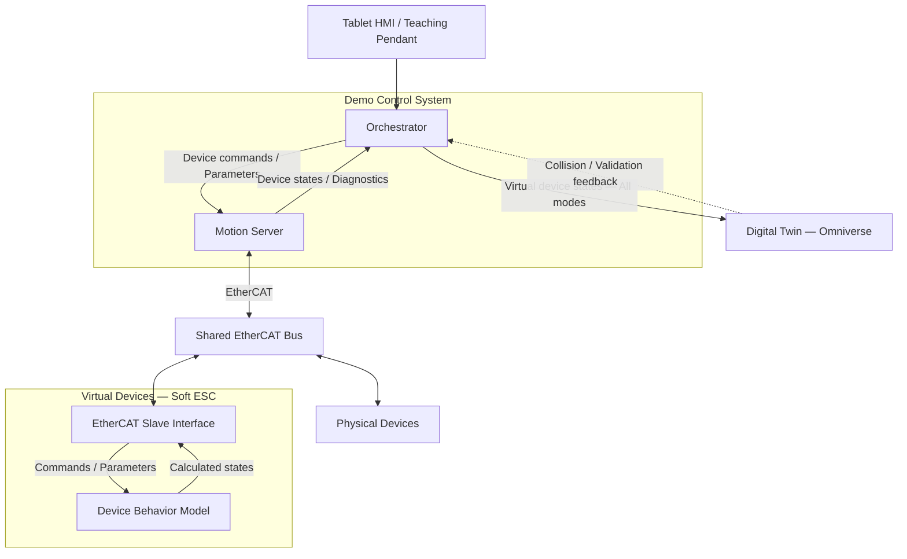
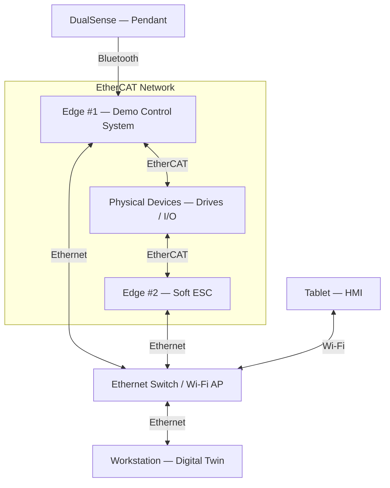
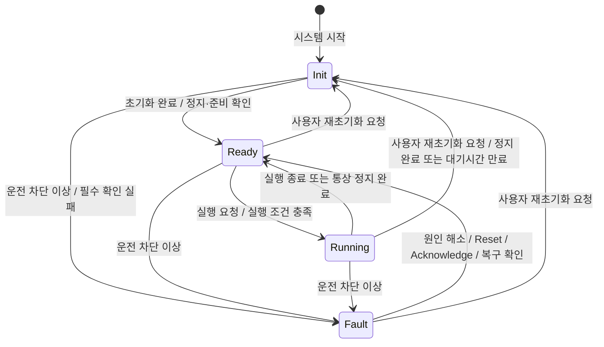

# Fieldbus 기반 Digital Twin 데모 — 작업 합의 및 원고

최종 갱신: 2026-11-23 (한국 시간)

## 1. 문서 목적과 작업 방식 — 확정

합의 내용과 슬라이드 원고를 지속적으로 기록한다. 후속 작업은 이 문서의 최신 내용을 기준으로 진행한다. 확정 사항과 검토 중인 내용을 구분한다.

- 최종 발표 자료는 기존 PPT를 바탕으로 작성한다.
- 슬라이드별 제목·핵심 메시지·본문을 먼저 논의하고 이 문서에 기록한다.
- Overview → Architecture → Detail Specification 전체 원고를 먼저 정리한다. 후속 설계 결과를 앞부분에도 반영하고 전체 일관성을 검토한 뒤 기존 PPT 형식으로 한 번에 제작한다.
- 합의가 바뀌면 본문과 결정 기록을 갱신한다.

## 2. 전체 구성 — 확정

Overview → Architecture → Detail Specification

| 섹션 | 답할 질문 | 내용 |
|---|---|---|
| Overview | 왜 만들고 무엇을 보여주는가? | 목적과 가치, 적용 공정과 컨셉, 데모 시나리오 |
| Architecture | 어떤 구성과 원리로 동작하는가? | 시스템·Fieldbus 구성, SW 역할, DT/Sync 데이터 흐름, PC·네트워크 |
| Detail Specification | 무엇을 구현해야 하는가? | 기능 요구사항, I/O·장비 사양, 상태 전이, 모드별 동작, pairing·alignment, 인터페이스·오류 처리 |

Architecture는 동작 원리와 역할을, Detail Specification은 구체적인 조건과 절차를 설명한다.

## 3. 기준 자료

사용자 공유 PPT: DTDemo_SWArchitecture_rev1.3
열람 파일: DTDemo_SWArchitecture_rev1.3(3).pptx, 20페이지.
원본의 개별 기술 항목은 설계 초안이며 향후 검토하면서 확정한다.

## 4. Overview 구성 — 작업 출발점

| 순서 | 가제 | 내용 | 상태 |
|---|---|---|---|
| 1 | Purpose & Value | Fieldbus layer까지 확장한 DT의 목적과 가치 | 목적 문장·Value 구조·영문 설명 확정 |
| 2 | Demo Application & Concept | Underfill 공정과 실제·가상 장비 활용 컨셉 | 문구·시각 구성 방향 확정 |
| 3 | Demonstration Scenario | 가상 티칭 → 가상 시운전 → 실제 실행 | 미작성 |

## 5. Purpose & Value

### 5.1 Purpose — 확정 문장

> Extend the Digital Twin down to the fieldbus layer, enabling seamless integration of control software, virtual devices and the physical machine across engineering and operation.

Digital Twin을 Fieldbus layer까지 확장하여, 엔지니어링부터 실제 운전까지 제어 소프트웨어·가상 장치·실제 설비를 유기적으로 연결한다.

목적의 상위 개념은 Digital Twin이다. Virtual Commissioning은 그 기반에서 보여주는 활용 사례 중 하나로 다룬다.

### 5.2 Value — 확정 키워드와 순서

| 순서 | Value | 합의한 의미 |
|---|---|---|
| 1 | Seamless Validation | 실제와 같은 Fieldbus 인터페이스를 통해 제어 로직과 장치 통신을 함께 검증 |
| 2 | Seamless Deployment | 검증한 제어 로직·레시피·선정된 파라미터를 실제 장비에 적용 |
| 3 | Seamless Synchronization | 운전 중 실제 장치의 위치·상태·진단 정보를 DT에 반영 |

검증 → 적용 → 운전의 흐름으로 제시한다. 일반적인 DT 장점보다 Fieldbus layer 확장으로 얻는 가치를 강조한다. 세 항목 모두 Seamless를 반복하여 메시지를 통일한다.

### 5.3 분류 결정의 근거

- 기존 Connectivity / Engineering / Operation은 기술 기반과 활용 단계가 섞여 중첩된다.
- Connectivity는 세 가지 가치를 가능하게 하는 기반으로 설명한다.
- 같은 제어 로직을 가상에서 실제로 재사용하는 가치는 Deployment에 포함한다. Control을 별도 가치로 분리하지 않는다.
- Feedback 대신 Synchronization으로 실제·가상 상태의 일치를 강조한다.
- Data Integrity를 Fieldbus 연결만으로 보장한다고 표현하지 않는다.

### 5.4 Value 영문 설명 — 확정

| Value | 슬라이드용 영문 |
|---|---|
| Seamless Validation | Validate control logic, recipes and selected device parameters, including device communication through a common fieldbus interface. |
| Seamless Deployment | Apply the validated control logic and recipes to the physical system, and transfer the validated device parameters to physical devices. |
| Seamless Synchronization | Keep the Digital Twin aligned with the states and diagnostics of physical devices through the same fieldbus interface. |

용어 기준: Fieldbus 계층의 드라이브·I/O 등은 physical devices로 표현한다. 제어 로직·레시피는 컨트롤러에서 실행되므로 배포 대상 전체는 physical system으로 표현하고, 장치에 전달하는 selected parameters와 구분한다. 위치는 device states에 포함하므로 별도로 나열하지 않는다.

### 5.5 미확정 사항

- Purpose & Value 슬라이드 배치.
- Industrial AI 부제의 강조 수준과 이번 데모의 직접적인 AI 기능 범위.

## 5A. Demo Application & Concept

### 확정된 시연 범위

- 실제 액체 토출 없이 갠트리 이동 경로만 시연한다.
- Underfill dispensing은 적용 공정의 맥락으로 소개한다. 실제 토출 또는 Underfill 품질 검증을 시연한다고 표현하지 않는다.
- 공정 흐름은 PCB Loading → Gantry Path Execution → PCB Unloading으로 표현한다. 장비 및 제어 상세는 Architecture 및 Detail Specification에서 구체화한다.

### 슬라이드 표현 — 확정

- Target Application: Underfill Dispensing
- Demonstration Scope: Gantry path execution without material dispensing.
- Process Flow: PCB Loading → Gantry Path Execution → PCB Unloading.
- Demo Concept: Validate virtually, deploy to the physical system, and synchronize physical device states with the Digital Twin through a common fieldbus interface.

### 시각 구성 방향 — 확정

- 중앙: 공정 흐름.
- 하단: Virtual Validation → Physical Deployment → State Synchronization.
- DT/Sync 모드의 구체적인 동작은 Architecture에서 설명한다.

## 5B. Demonstration Scenario

### 첫 단계: Development Story — Video — 확정

첫 순서는 동영상으로 이 데모 자체의 개발 과정을 소개한다. 실물 장비가 없는 상태에서 DT로 데모를 먼저 개발했고, 그 개발 과정에서 제안하는 세 Value가 실제로 실현되었다는 점을 전달한다.

> Built virtually. Proven physically.
>
> This demo was developed in the Digital Twin before the physical machine was available—demonstrating seamless validation, deployment and synchronization throughout its development.

용어 기준: 이 문장의 physical machine은 완성된 데모 장비 전체를 뜻한다. Fieldbus에 연결되는 개별 대상을 설명할 때 사용하는 physical devices와 구분한다. physical setup 대신 physical machine을 사용한다.

영상 구성 방향 제안: 실물 없이 수행한 가상 개발·검증 → 실물 구축 후 적용 → 실제 상태 동기화의 시간 순서로 보여준다.

### 이후 라이브 시연 흐름 — 발표 구성 미확정

1. Virtual Teaching & Configuration: DT 조그·경로 티칭, 레시피·속도·가감속 설정.
2. Virtual Validation: 가상 로딩·경로 이동·언로딩 시퀀스, 경로·충돌·한계·통신 확인.
3. Deployment to the Physical System: 검증 결과 적용 및 실제 위치 기준 DT 정렬.
4. Physical Execution & DT Synchronization: Sync 모드에서 실제·가상 시퀀스 병렬 실행, Omniverse는 가상 장치 상태 추종. Festo AX는 이번 1차 시연에서 제외한다.

## 5C. Architecture — 동작 모델 배치 및 범위 결정

결정일: 2026-11-20 (한국 시간)

### 이번 데모 — 확정

- 동작 모델은 현재처럼 Soft ESC 측에 둔다. 현재 Slave 및 Model Host의 논리적·프로세스 경계를 유지한다.
- DT 모드에서는 Soft ESC 측 모델이 가상 장치 상태·위치를 계산하고 Omniverse는 그 결과 위치를 추종한다.
- Sync 모드에서는 Orchestrator가 페어링된 실제·가상 장치에 같은 지령을 보낸다. 가상 장치는 자체 모델로 동작을 계산하며 Omniverse는 모드에 관계없이 항상 가상 장치 상태를 추종한다.
- Omniverse는 이번 범위에서 장치 동작을 별도로 중복 계산하지 않는다. 기존 3D 표현·충돌/한계 검증 역할은 유지한다. 연결 단절은 17.9, 충돌 검출·복구는 17.10의 확정 규칙을 따른다. 한계 검증의 구체적인 대상·판정 범위는 추가 구현 확인 항목이다.

## 5D. System Architecture — 구성 요소 명칭

### 확정 명칭

- 상위 제어 영역 명칭은 **Demo Control System**으로 한다. 기존 Edge Control Platform 명칭을 대체한다.
- Motion Server는 상위 영역에 숨기지 않고 별도 블록으로 표시한다.

### 내부 블록 명칭 및 역할 — 확정

Demo Control System 내부는 Orchestrator와 Motion Server 두 블록으로 표시한다. 책임 경계와 연결 관계는 5E~5H 및 17장의 확정 내용을 따른다.

| 블록 | 역할 |
|---|---|
| Orchestrator | 시퀀스·운전 모드·명령 및 피드백 라우팅·HMI/Pendant 입력 관리 |
| Motion Server | EtherCAT Master·장치 제어·PDO/SDO 통신 |

물리 PC 경계와 논리 SW 영역은 구분한다. 하드웨어 배치는 5K, Digital Twin 인터페이스는 17.8~17.12를 따른다. Festo AX는 2차 범위로 분리한다.

## 5E. System Architecture — 모드별 명령 및 상태 경로 — 확정

- Orchestrator가 실제·가상 장치 pairing을 기준으로 지령 대상을 결정한다.
- DT 모드: 가상 장치에 지령을 보낸다. 실제 장치의 동작 명령은 차단한다.
- Sync 모드: 페어링된 실제·가상 장치에 같은 지령을 보낸다.
- 두 모드 모두 가상 장치 동작은 Soft ESC 측 자체 모델이 계산한다.
- Omniverse는 모드와 관계없이 항상 가상 장치 상태와 동기화된다. 실제 장치 상태를 직접 추종하는 경로로 전환하지 않는다.
- Sync는 동일 지령으로 실제·가상 장치를 병렬 구동하는 의미다. 동일 지령이 실제·가상 상태의 완전 일치를 보장하지 않는다.
- 지령 대상과 DT 상태 전달 경로는 Orchestrator → Motion Server → EtherCAT → 장치 및 가상 장치 상태 → Motion Server → Orchestrator → Omniverse로 표현한다.
- 실제 장치 상태 역시 Motion Server를 통해 Orchestrator에서 수집한다.

### Overview 표현과 상세 구조의 관계

- Overview의 Seamless Synchronization은 기존 합의 문구를 유지한다(2026-11-20 사용자 결정). 상세 데이터 흐름은 5E를 따른다. Overview 문구 유지는 실제 상태 직접 추종 경로를 추가한다는 의미가 아니다.
- 기존 Demonstration Scenario의 실제 상태 동기화·미러링 표현도 같은 기준으로 재검토한다.
- State Alignment의 실행 방식과 Parameter Pairing 범위는 16장, HMI 표시는 18.6을 따른다. 아직 남은 허용 조건·PDO 재구성 절차는 20장에 모아 관리한다.

## 5F. Orchestrator / Motion Server 책임 경계 — 확정

| 기능 | Orchestrator | Motion Server |
|---|---|---|
| 실제·가상 pairing | 페어링 테이블 보유·관리 | 개별 장치 ID로 접근 |
| DT/Sync 모드 | 모드에 따라 지령 대상 결정 | 지정된 대상의 장치 제어 실행 |
| 시퀀스·티칭·레시피 | 생성·관리·실행 | 장치 제어 수행 |
| 동일 지령 분배 | 페어링된 실제·가상 대상에 같은 논리 지령 전달 | 각 장치의 PDO/SDO 처리 |
| 상태 수집 | 실제·가상 상태 취합, 가상 상태를 Omniverse에 전달 | 장치별 피드백 제공 |

Motion Server는 실제·가상 장치를 일반 EtherCAT 장치로 취급한다. Pairing 및 데모 운전 모드는 Orchestrator가 담당한다.

동일 논리 지령 전달은 동일 EtherCAT 주기 실행 또는 실제·가상 상태의 완전 일치를 보장하지 않는다. 이번 범위에서는 CSP·축간 동기화·보간을 사용하지 않는다(14.1). 실제·가상 상태 차이는 Diagnostics에서 비교하며 차이만으로 Fault를 발생시키지 않는다(18.7).

## 5G. Festo AX 범위 — 확정

- Festo AX는 2차 구현 범위이다.
- 현재 1차 Architecture에서 센서 수집·Remote I/O·통신·데이터 흐름·제어 연계 등 세부 사항을 정의하지 않는다.
- 전체 관계도에 포함할 경우 2차 구현 영역임을 표시하고 세부 연결선은 생략한다.
- 1차 핵심 구조는 Demo Control System, Physical Devices, Virtual Devices — Soft ESC, Digital Twin — Omniverse로 정리한다.

## 5H. 1차 System Architecture 관계도 — 확정



Festo AX는 2차 구현으로 분리하여 1차 관계도에서 생략한다.

## 5I. Fieldbus Integration — 확정

### 핵심 메시지

> Physical and virtual devices remain connected to a common EtherCAT bus, with command targets selected by the Orchestrator.

| 항목 | 설명 |
|---|---|
| Common EtherCAT Bus | Motion Server 한 인스턴스가 실제·가상 장치와 통신 |
| Always Connected | 모드와 관계없이 실제·가상 Slave의 연결 및 주기 통신 유지 |
| Device Pairing | Orchestrator가 대응하는 실제·가상 장치 ID 관계 관리 |
| Command Routing | DT는 가상 장치만, Sync는 페어링된 실제·가상 장치에 동일 지령 |
| Consistent Device Interface | Motion Server는 실제·가상 구분 없이 개별 EtherCAT 장치로 제어 |

Pairing은 서로 다른 Slave ID를 논리적으로 연결하는 것이다. Physical X와 Virtual X는 각각 독립 Slave로 유지된다. 버스 연결은 유지하고 지령 대상만 선택한다. 모드별 상세 데이터 흐름은 다음 장에서 다룬다.

## 5J. Operating Modes & Data Flow — 확정

핵심 메시지: Manual/Auto는 지령 생성 방식을, DT/Sync는 지령 대상을 결정한다.

| 모드 | 지령 생성 | 지령 대상 | Omniverse 추종 |
|---|---|---|---|
| DT · Manual | Pendant / HMI 조작 | 가상 장치 | 가상 장치 상태 |
| DT · Auto | 레시피 기반 시퀀스 | 가상 장치 | 가상 장치 상태 |
| Sync · Manual | Pendant / HMI 조작 | 페어링된 실제·가상 장치 | 가상 장치 상태 |
| Sync · Auto | 레시피 기반 시퀀스 | 페어링된 실제·가상 장치 | 가상 장치 상태 |

모드별 속도 제한 및 전환 조건은 Detail Specification에서 정의한다.

## 5K. Hardware & Network Topology — 확정

| 하드웨어 | 기능 | 실행 소프트웨어 | 네트워크 연결 |
|---|---|---|---|
| Edge #1 | Demo Control System | Orchestrator + Motion Server | EtherCAT Master NIC + Ethernet NIC |
| Edge #2 | Soft ESC | Slave 인터페이스 + 동작 모델 | EtherCAT Slave NIC + Ethernet NIC |
| Workstation | Digital Twin | Omniverse | Ethernet NIC |
| Tablet | HMI | Web Browser | Wi-Fi |
| DualSense | Pendant | N/A | Bluetooth — Edge #1 연결 |



- 표의 첫 열은 하드웨어 식별, 다음 열은 기능, 다음 열은 실행 소프트웨어로 구분한다.
- EtherCAT 연결선은 물리 배선 순서를 나타낸다. 실제·가상 장치는 각각 독립 Slave로 Motion Server와 통신한다.
- Ethernet은 Orchestrator–Omniverse 통신, HMI 접속 및 Edge #2 접속 등에 사용한다. 연결선에는 용도가 아닌 통신 방식 Ethernet을 표시한다.
- DualSense는 Edge #1에 Bluetooth로 연결한다.
- Festo AX는 2차 범위이므로 현재 표·연결도에서 생략한다.

## 6. 검토 항목의 현재 상태

- 동작 모델 배치, 모드별 지령·피드백 경로, 장치 I/O 사양 배치 및 동작 완료 판정은 5C~5K와 10~19장에서 구체화했다. 이전의 포괄적인 미확정 목록을 반복하지 않는다.
- CMMT FMU와 단순 동작 모델의 실제 적용 범위·검증 수준은 구현 확인 항목이다. Omniverse에 모델을 통합하는 후속 제품 기능은 이번 데모 명세에 추가하지 않는다.
- 현재 남은 설계 판단·구현 값·발표 편집 항목은 20장의 검토 결과로 통합한다.

## 7. 결정 기록 — 이력

아래는 당시 결정의 시간순 이력이다. 이후 변경된 사항은 본문의 최신 확정 절과 20장을 우선한다.

| 날짜 | 합의 |
|---|---|
| 2026-11-19 | Overview → Architecture → Detail Specification 순서 확정 |
| 2026-11-19 | 슬라이드 단위 원고를 먼저 정리하고 섹션별로 기존 PPT에 반영 |
| 2026-11-19 | 별도 문서에 합의를 기록하며 지속 갱신 |
| 2026-11-19 | Purpose를 Virtual Commissioning이 아닌 Digital Twin의 Fieldbus 확장으로 표현한 문장 확정 |
| 2026-11-19 | Value를 Seamless Validation → Seamless Deployment → Seamless Synchronization으로 확정. Control의 로직 재사용은 Deployment에 통합 |

| 2026-11-19 | 정정: 세 Value 영문 설명은 미확정. Validation과 Deployment의 대상 일치 및 Synchronization과의 용어 일관성을 검토 중 |

| 2026-11-19 | 사용자 승인으로 5.4의 수정 문구 확정. Validation과 Deployment의 검증 대상을 control logic, recipes, selected device parameters로 일치시키고 Synchronization은 같은 Fieldbus 인터페이스의 상태·진단 반영으로 정의 |

| 2026-11-19 | 실제 액체 토출 없이 갠트리 이동 경로만 시연하는 범위 확정 |

| 2026-11-19 | Demo Application & Concept의 Target Application, Demonstration Scope, Process Flow, Demo Concept 문구 및 중앙 공정·하단 가치 흐름의 시각 구성 방향 확정 |

| 2026-11-19 | 시연 첫 단계는 DT 선행 개발과 세 Value 실현 과정을 동영상으로 소개. Built virtually. Proven physically. 및 physical machine을 사용한 설명 문구 합의. 이후 라이브 단계는 제안 상태 유지 |

| 2026-11-20 | 전체 원고 및 일관성 검토 후 PPT를 한 번에 제작하는 방식으로 변경 |
| 2026-11-20 | 이번 데모는 Soft ESC 측 동작 모델 + Omniverse 위치 추종 유지 |

| 2026-11-20 | 후속 제품 기능 요구사항은 PPT 작업 문서가 아닌 Soft ESC RF에서 관리하도록 분리 |

| 2026-11-20 | 상위 제어 영역 명칭을 Demo Control System으로 확정. Motion Server를 별도 블록으로 표시 |

| 2026-11-20 | Demo Control System 내부 상위 제어 블록 명칭을 Orchestrator로 확정 |

| 2026-11-20 | Sync는 실제·가상 장치 동일 지령 병렬 구동. Omniverse는 모든 모드에서 가상 장치 상태만 추종하도록 확정. 이전 실제 상태 직접 추종 설명을 대체 |

| 2026-11-20 | Orchestrator는 pairing·모드·레시피·지령 분배·상태 취합을 담당하고 Motion Server는 장치 ID 기반 제어·PDO/SDO·피드백을 담당하도록 확정 |

| 2026-11-20 | Festo AX는 2차 구현 범위로 확정. 현재 Architecture에서 세부 기능·연결 정의를 진행하지 않음 |

| 2026-11-20 | 1차 System Architecture 관계도 및 Fieldbus Integration 핵심 문구·5개 설명 항목 확정 |

| 2026-11-20 | Operating Modes & Data Flow의 2×2 표와 지령 생성 방식/대상 구분 메시지 확정 |

| 2026-11-20 | Hardware & Network Topology 확정. Edge #1 / Edge #2 / Workstation의 기능 구분, Tablet Wi-Fi, DualSense Bluetooth 연결 및 Ethernet 표기 통일 |

| 2026-11-20 | Seamless Synchronization 영문은 기존 합의 문구 유지. Architecture의 실제·가상 동일 지령 및 DT의 가상 상태 추종 구조도 유지 |

## 8. 현재 작업 상태

Overview → Architecture → Detail Specification의 기능 합의와 HMI·Pendant 구성을 기록했다. 전체 문서의 중복·상충·미정 항목 검토 결과는 20장을 따른다. 기존 합의를 반복하거나 설정파일 구성을 별도 신규 의제로 추가하지 않는다. 최종 PPT 편집은 원고 정합성 및 발표 구성 정리 후 진행한다.

## 9. PPT 중간본 제작 (2026-11-20)

사용자 요청으로 상세 사양 완성 전 Overview와 Architecture를 PPT 중간본으로 제작했다. 당시 보류한 Detail Specification은 이후 10~19장에서 논의했다. 이 절은 중간본 제작 이력이며 현재 상세 사양의 보류를 뜻하지 않는다.

- 파일: Festo_DT_Demo_Overview_Architecture_v1.pptx
- 구성: 표지, Purpose & Value, Demo Application & Concept, Demonstration Scenario, System Architecture, Fieldbus Integration, Operating Modes & Data Flow, Software Responsibilities, Hardware Allocation, Hardware & Network Topology (총 10장).
- 기존 공유 PPT의 이미지와 색상을 활용했다. 원본 파일은 변경하지 않았다.
- 동영상 파일은 제공되지 않아 Development Story의 소개 문구와 시연 단계만 포함했다.
- Festo AX 및 Soft ESC 후속 모델 선택 RF는 자료에 포함하지 않았다.
- PPT: https://chatgpt.com/library?file_id=libfile_fde3_f-b9bee7e467a48191a60ac4415fb7438f_3956a119e3f08191a57d89514d44ac82&account_id=personal

### PPT 관계도 표현 변경

사용자 요청에 따라 System Architecture(5장) 및 Hardware & Network Topology(10장)의 관계도를 합의한 Mermaid 구조 기반 고해상도 이미지로 교체했다. 나머지 8개 슬라이드는 유지했다. 제목·설명·표는 편집 가능한 상태를 유지하며, 이미지 관계도의 Mermaid 원문은 해당 슬라이드 노트에 보관했다. 관계도 이미지 교체본은 v2이며, 이후 PowerPoint 복구 문제로 표 XML을 수정한 작업본은 Festo_DT_Demo_Overview_Architecture_v4.pptx이다. 기존 PPT의 동일 문서 링크를 사용한다. v4의 실제 Microsoft PowerPoint 열기 결과는 사용자 확인이 남아 있으며, 이번 문서 검토에서 PPT 파일은 변경하지 않았다.

## 10. Detail Specification — Device & I/O Specification

### 10.1 Motion Devices — 구성 원칙

- 구동축은 X1·Y·Z 3축이며 모터와 컨트롤러를 별도 열로 관리한다.
- X2는 모터·컨트롤러 없이 부하를 지지하는 Guide Axis이다. 독립 가상 드라이브나 별도 구동 명령을 추가하지 않고 DT에서 기구 관계로 표현한다.
- 중복된 이전 합산 열 표는 제거한다. 모델·수량은 10.2의 통합 BOM을 기준으로 관리한다. 미선정 모델을 확정값으로 간주하지 않는다.

### 10.2 1차 구현 전체 BOM — 작업용 통합표 (2026-11-23)

축·모터·컨트롤러를 별도 열로 구분한다. 아래 수량은 데모 구성 기준이며 발주 확정 수량은 아니다. 미정 모델·수량은 TBD로 관리한다. Festo AX는 2차 범위로 상세 BOM에서 제외한다.

#### Motion Devices

| 기능 | 축 | 모터 | 컨트롤러 | 수량 | 가상 대응 |
|---|---|---|---|---|---|
| X1 | EGC-70-370-TB-KF-0H-GK (556813) | TBD | CMMT-AS-EC | 각 1 | 가상 드라이브 + 동작 모델 |
| X2 | Guide Axis — 상세 기종 TBD | 없음 | 없음 | 축 1 | DT 기구 표현 |
| Y | EGC-80-300-TB-KF-0H-GK (556814) | TBD | CMMT-AS-EC | 각 1 | 가상 드라이브 + 동작 모델 |
| Z | ELGD-BS-KF-80-300-0H-… (상세 형번 TBD) | TBD | CMMT-AS-EC | 각 1 | 가상 드라이브 + 동작 모델 |

구동축 3축 + Guide Axis 1축. 모터 3대, 컨트롤러 3대. 모터의 상세 모델 및 축·모터 결합 부품은 후속 확정한다. X1/Y/Z 축 형번은 기존 PPT의 기재를 유지한 작업 기준이다.

#### Loader / Pneumatic / I/O

| 기능 | 품목 | 모델·사양 | 수량 | 비고 |
|---|---|---|---|---|
| Loader | 실린더 | DGC-32-300-… | 1 | 상세 형번 TBD |
| Loader 제어 | 밸브 | 상세 TBD | 1식 | 기존 PPT의 single valve 및 VTUX 표기 간 구성 정리 필요 |
| Loader 위치 감지 | 리미트 센서 | 24 VDC, DI | 2 | 실린더 양단 |
| EtherCAT I/O 연결 | Remote I/O | CPX-E-EC / CPX-AP-I-EC-M12 후보 | 1식 | 최종 선정 TBD |
| 센서 입력 | DI 채널·모듈 | 24 VDC, 최소 2점 | 모듈 수 TBD | Remote I/O 구성에 포함 |
| 밸브 출력 | DO 채널·모듈 | 밸브 구성에 따라 확정 | TBD | Remote I/O 구성에 포함 |

I/O 채널·모듈은 Remote I/O 구성의 하위 항목이며 별도 완제품 수량으로 중복 합산하지 않는다. 가상 측에는 밸브 명령·실린더 이동·양단 센서 응답이 필요하며 상세 구현 사양은 후속 논의한다.

#### Computing / HMI / Network

| 하드웨어 | 기능 | 소프트웨어·연결 | 수량 |
|---|---|---|---|
| Edge #1 | Demo Control System | Orchestrator + Motion Server; EtherCAT Master NIC + Ethernet NIC | 1 |
| Edge #2 | Soft ESC | Slave 인터페이스 + 동작 모델; EtherCAT Slave NIC + Ethernet NIC | 1 |
| Workstation | Digital Twin | Omniverse; Ethernet NIC | 1 |
| Tablet | HMI | Web Browser; Wi-Fi | 1 |
| DualSense | Pendant | Edge #1에 Bluetooth 연결 | 1 |
| Ethernet Switch | 일반 Ethernet 연결 | 포트 수·모델 TBD | 1 |
| Wi-Fi AP | Tablet 무선 연결 | 모델 TBD | 1 |
| EtherCAT 케이블 | 제어망 배선 | 길이·커넥터 TBD | TBD |
| Ethernet 케이블 | 일반망 배선 | 길이 TBD | TBD |

Switch와 AP는 통합 장비 사용 여부에 따라 실제 구매 수량을 조정한다. PC 상세 모델·NIC 및 Bluetooth의 내장/추가 구성은 후속 확정한다. 전원·구동 배선·공압 배관·장착 부품은 상세 구성 확정 후 추가 산출한다. 실제 토출 장치는 포함하지 않는다.

## 11. Detail Specification — Operation & State Management

### 11.1 System State — 명칭 및 정의 확정 (2026-11-23)

| 상태 이름 | 정의 |
|---|---|
| Init | 시스템을 시작하고 통신·장치·설정의 초기화 및 준비 상태를 확인하는 상태. |
| Ready | 시스템 초기화를 완료하고 수동 동작 또는 자동 시퀀스의 시작을 기다리는 상태. |
| Running | Jog·Move 등 수동 동작 명령 또는 자동 시퀀스를 실행 중인 상태. 자동 시퀀스 안의 센서 확인·타이머 대기 등 일시적인 비이동 구간도 포함한다. |
| Fault | 운전을 차단해야 하는 이상을 감지하여 정상 운전을 차단하고, 원인 해소 및 명시적인 복구 절차를 기다리는 상태. |

- 기존 시스템 상태 명칭 OP는 Running으로, Error는 Fault로 대체한다.
- 위 상태는 Demo Control System의 시스템 상태이다. EtherCAT OP 및 개별 드라이브의 CiA402 Operation Enabled/Fault와 구분한다.
- Error는 명령 실패·잘못된 입력 등의 개별 오류·응답을 표현하는 용어로 사용할 수 있다. 모든 Error가 시스템 Fault 전환을 의미하지는 않는다.
- Running은 물리적 이동 여부만으로 판정하지 않는다. 자동 시퀀스의 대기 구간에서도 실행이 계속되는 동안 Running을 유지한다.
- 실행 종료 또는 정지 완료 후 Ready로 복귀하는 것을 기본 방향으로 한다. 진입·이탈 조건, Homing, Fault 복구·재초기화는 11.2~11.5를 따른다. 아직 미정인 개별 작업 허용 조건은 20장에서 구분한다.

상태 전이·복구·재초기화는 11.2~11.5의 확정 규칙을 따른다.

### 11.2 System State Transitions — 확정 (2026-11-23)

| 전이 | 조건 | 주요 처리 |
|---|---|---|
| 시작 → Init | 시스템 시작 | 설정 로드, 통신 연결, 장치 구성·pairing 확인 |
| Init → Ready | 초기화 완료, 필요한 통신·장치 정상, 대상 장치 정지·현재 모드의 준비 상태 확인, 운전 차단 Fault 없음 | 명령 대기 |
| Ready → Running | 유효한 실행 요청 및 현재 모드의 실행 조건 충족 | 동작·시퀀스 실행 |
| Running → Ready | 동작·시퀀스 종료 또는 통상 정지 완료 | 실행 종료 처리 |
| Init / Ready / Running → Fault | 운전을 차단해야 하는 이상 또는 초기화 후 필수 확인 실패 | 신규 동작 차단, 필요한 정지 처리, 원인 기록 |
| Fault → Ready | 원인 해소, 필요한 Reset, 사용자 Acknowledge 및 정지·준비 상태 확인 완료 | 신규 명령 대기, 이전 동작 자동 재개 없음 |
| Ready / Running / Fault → Init | 사용자 재초기화 요청 | 공통 재초기화 절차 수행. 정지 응답은 제한 시간까지만 대기하며 정지 실패·미확인도 기록 후 Init 진행 |
| Init → Init (유지) | 초기화 중 중복 재초기화 요청 | 중복 실행을 시작하지 않고 현재 초기화 계속 수행 |



초기화 중 중복 요청은 현재 초기화를 유지하는 처리이며 별도 상태 전이를 시작하지 않는다. 관계도의 Running → Init 전이에는 신규 동작 차단, 명령 취소 및 제한 시간 내 정지 시도가 포함된다.
### 11.3 모드별 실행 조건 — 확정

| 운전 모드 | 실행 전 확인 조건 |
|---|---|
| DT · Manual | 가상 장치 준비, 선택된 Manual Control Source의 유효한 입력, 요청 동작의 실행 조건 충족 |
| DT · Auto | 가상 장치 준비, 유효한 레시피 로드, 시퀀스 시작 조건 충족 |
| Sync · Manual | 페어링된 실제·가상 장치 모두 준비, 선택된 Manual Control Source의 유효한 입력, 수동 속도 제한 적용 |
| Sync · Auto | 페어링된 실제·가상 장치 모두 준비, 유효한 레시피와 필요한 파라미터·상태 정렬 완료 |

### 11.4 상태 관리 원칙 — 확정

- Ready와 개별 동작의 실행 조건을 구분한다. 모든 축의 Homing 완료를 Ready 진입의 일괄 조건으로 두지 않는다.
- Homing은 Ready에서 시작하고 실행 중에는 Running으로 관리하며, 정상 완료 후 Ready로 복귀한다.
- 통상 정지 요청은 정지 진행 중 Running을 유지하고 정지 완료 후 Ready로 복귀한다. 사용자 재초기화 요청은 아래 공통 재초기화 절차를 적용하며 정지 완료를 무한정 기다리지 않는다.
- 운전 차단 이상 감지 시에는 정지 완료 여부와 별개로 Fault로 전환하고 필요한 정지 처리를 수행한다. Fault라는 상태 이름 자체가 이미 물리적 정지가 완료되었다는 의미는 아니다.
- Fault는 원인 해소만으로 자동 해제하지 않는다. 필요한 장치 Reset 및 사용자 Acknowledge 후 정지·현재 모드의 준비 상태를 확인하여 Ready로 복귀한다. 확인 조건을 충족하지 못하면 Fault를 유지한다.
- 시스템이 재초기화 필요성을 판단하여 자동으로 Init으로 전환하지 않는다. Init 재진입은 사용자의 명시적인 재초기화 요청으로만 수행한다.
- 이전 이동이나 시퀀스를 자동으로 재개하지 않는다.
- DT/Sync 및 Manual/Auto 전환은 Ready에서만 허용한다.
- 세부 준비 판정, 속도 제한 수치, 정렬 완료 판정, timeout 및 Fault별 정지 방식은 후속 상세 명세에서 정의한다.

### 11.5 Fault 복구 및 공통 재초기화 — 확정 (2026-11-23)

- 일반 Fault 복구는 원인 해소 → 필요한 Reset → 사용자 Acknowledge → 정지·준비 상태 확인 → Ready 순서로 수행한다. 원인 해소만으로 자동 복귀하지 않는다.
- 재초기화는 특정 상태에 종속된 복구 경로가 아니라 모든 상태에서 요청 가능한 공통 명령이다.
- 시스템이 재초기화 필요성을 판단하여 자동 Init 전환하지 않으며 사용자가 명시적으로 요청한다.
- Init 중 중복 요청은 기존 초기화를 계속 수행하며 중복 초기화를 시작하지 않는다.

| 단계 | 처리 |
|---|---|
| 1. 실행 차단 | 신규 동작 차단, 현재 시퀀스 및 대기 명령 취소 |
| 2. 정지 시도 | 대상 장치에 정지 요청, 정해진 시간까지만 응답 대기 |
| 3. Init 진행 | 정지 완료 또는 대기시간 만료 후 초기화 진행. 정지 실패·미확인은 기록하며 Init 진입을 무한정 차단하지 않음 |
| 4. Ready 진입 확인 | 초기화 후 대상 장치의 정지·통신·준비 상태 확인. 충족하면 Ready, 확인 실패 시 Fault |

재초기화 과정에서 이전 지령을 다시 보내거나 장치를 자동 Enable하지 않으며 이전 동작을 자동 재개하지 않는다. 정지 대기 제한 시간과 세부 준비 판정은 후속 명세한다. 시스템 상태와 개별 장치 상태는 기존에 합의한 분리를 유지한다.

## 12. Detail Specification — Manual Control 및 모드 선택

합의일: 2026-11-23. 아래는 현재까지 합의한 범위이며 세부 입력 매핑·속도 제한 수치는 후속 정의한다.

### 12.1 모드 계층 — 확정

기존 DT/Sync × Manual/Auto를 유지하고 Manual 하위에 조작 주체와 주체별 조작 방식을 구분한다.

| 구분 | 값 | 의미 |
|---|---|---|
| Target Mode | DT / Sync | 지령 대상 결정 |
| Operation Mode | Manual / Auto | 수동 조작 / 자동 시퀀스 실행 |
| Manual Control Source | HMI / Pendant | Manual에서 지령을 생성하는 조작 주체 선택 |
| Manual Control Mode | 선택한 조작 주체별 모드 | 아래 표의 조작 방식 선택 |

| 조작 주체 | Manual Control Mode | 동작 | 특이 사항 |
|---|---|---|---|
| Pendant | Single Axis | 선택한 단축 Jog | 기존 조그 방식 유지 |
| Pendant | Multi Axis | DualSense 스틱 입력으로 다축 PV 운전 | Orchestrator에서 S/W Limit까지의 상대거리를 고려한 속도 제한 적용 |
| HMI | Jog | 지정 축 Jog 조작 | Single/Multi Axis 모드 구분 없음 |
| HMI | Positioning | 목표 위치 지정 PP 운전 | Single/Multi Axis 모드 구분 없음. HMI 표시명은 Positioning, 사양상의 Drive Mode는 PP |

Jog는 본 문맥에서 Single Axis Pendant 및 HMI의 조작 기능을 가리킨다. Pendant Multi Axis의 PV 지령 생성 기능과 명칭·책임을 구분한다. 제어축은 X1/Y/Z이며 X2 Guide Axis는 독립 구동 명령 대상이 아니다.

### 12.2 DualSense Trigger — 확정

Manual Mode에서 기존 Trigger와 Enable(Servo On/Off)의 직접 연결을 유지한다. 별도의 조작 허가 버튼 기능이나 Trigger 해제 시 정지 요청 → 정지 확인 → Servo Off 순서를 새로 도입하는 제안은 채택하지 않는다. Trigger–Enable의 직접 연결을 유지하되 물리 입력 매핑은 19.1에 따라 설정파일로 관리한다.

Servo On 상태 자체를 Running으로 취급하지 않는다. 시스템 상태는 동작·시퀀스 실행 여부를 기준으로 관리한다.

### 12.3 Pendant Multi Axis Velocity Control — 확정 범위

- PV 운전을 유지한다.
- DualSense 스틱으로 다축 속도 지령을 생성한다.
- S/W Limit을 넘어가지 않도록 현재 위치와 한계 위치 사이의 상대거리를 고려하여 속도를 제한한다.
- 이 기능은 Motion Server의 일반 Jog 기능이 아니라 Orchestrator의 Multi Axis Velocity Control에 포함한다.
- 처리 흐름: 스틱 입력 → 다축 속도 벡터 생성 → 한계 거리 기반 속도 제한 → Motion Server에 장치별 지령 전달.
- Motion Server는 전달받은 장치별 지령을 실행한다. 기존 장치 제어·통신 책임은 유지한다.
- 이 기능을 Single Axis Jog와 혼동하여 Jog 지령 생성 기능으로 명명하지 않는다.

속도 제한 계산식, 감속·지연·여유 거리, 갱신 주기, 실제·가상 상태를 고려하는 상세 방식, 다축 방향 유지 정책 및 한계에서의 반대 방향 이동 처리 등은 후속 검토·명세한다. 거리 기반 제한의 구현이 완료되었거나 검증되었다는 의미는 아니다.

### 12.4 HMI 선택 및 Orchestrator 관리 — 확정

| 항목 | 선택 UI | 관리·검증·적용 주체 |
|---|---|---|
| Target Mode — DT / Sync | HMI | Orchestrator |
| Operation Mode — Manual / Auto | HMI | Orchestrator |
| Manual Control Source — HMI / Pendant | HMI | Orchestrator |

- HMI는 선택 요청을 전달하고 Orchestrator가 Ready 상태 및 전환 조건을 검증하여 적용한다.
- Orchestrator가 실제 적용 결과를 HMI에 반환한다. HMI는 버튼 클릭만으로 선택을 확정하지 않고 반환된 실제 적용 상태를 표시한다.
- 전환 요청이 거부되면 현재 선택을 유지하고 거부 이유를 표시한다.
- Manual Control Source는 Manual에서만 적용한다. Auto의 지령 생성은 Orchestrator의 Sequencer가 담당한다.
- Manual에서는 한 번에 하나의 Control Source만 일반 동작 지령을 보낼 수 있다.
- Control Source 및 Manual Control Mode 변경도 Ready에서만 허용한다.
- Stop 및 사용자 재초기화 요청은 선택된 조작 주체와 별도로 처리한다. Pendant가 선택되어 있어도 HMI의 Stop·재초기화 요청은 사용 가능하다.
- HMI의 Jog/Positioning 기능은 18.4, Pendant 기능·물리 입력 매핑 분리는 19장을 따른다. 구체적인 버튼 배치는 고정하지 않는다.

## 13. Detail Specification — Auto Control

### 13.1 반복 실행 관리 — 확정 요구사항 (2026-11-23)

Orchestrator의 상위 자동 운전 관리가 한 사이클 Sequence의 실행 결과와 Repeat 옵션을 관리한다. 공정 Sequence와 책임을 분리하며 자동 운전 관리에 포함한다.

| 상황 | 상위 자동 운전 관리의 동작 |
|---|---|
| 사용자 Start | Running 진입 및 첫 사이클 실행 |
| 정상 완료 + Repeat OFF | 전체 실행 종료 후 Ready 복귀 |
| 정상 완료 + Repeat ON | Running 유지, 내부적으로 다음 사이클 시작 |
| Stop | 반복 예약 취소 및 기존 정지 절차 수행. 정지 완료 후 Ready |
| Fault | 반복 예약 취소 및 Fault 처리. 복구 후 자동 재개하지 않음 |
| 사용자 재초기화 | 반복 예약·현재 실행·대기 명령 취소 후 공통 재초기화 절차 수행 |

- Repeat OFF/ON은 HMI에서 Ready 상태에 선택하고 Orchestrator가 적용한다.
- Repeat ON 선택 자체는 자동 시작을 의미하지 않으며 사용자 Start가 필요하다.
- 사용자 Start는 전체 자동 실행을 시작하는 명령이다. 내부 Start Cycle은 Running 상태 안에서 다음 한 사이클을 실행하는 호출로 구분한다.
- 다음 사이클은 명시적인 정상 완료 결과를 받은 경우에만 시작한다. 시스템이 Ready가 되었다는 이유만으로 재시작하지 않는다.
- 매 사이클의 Start Check 및 단계 완료 조건을 유지한다.
- 중단한 실행은 사용자 새 Start 없이는 재개하지 않는다.

자동 운전 규칙은 13.2~13.3, HMI는 18.3, Pendant 요청은 19.2를 따른다. 실제 좌표·시간 값은 구현 시 확정한다.


### 13.2 Start / Stop / 재실행 — 확정 (2026-11-23)

| 항목 | 동작 |
|---|---|
| 조작 UI | HMI에서 Start / Stop / Repeat 선택. Pendant에서도 Auto Start / Stop 요청 허용(19.2); Repeat 설정은 HMI |
| 실행 주체 | Orchestrator가 Cycle Preparation 및 Sequence·반복 관리 |
| Start 허용 상태 | Auto · Ready |
| Start 조건 | 유효한 Recipe, 대상 장치 기본 준비, 필요한 축의 Servo On·Homing 조건 충족 |
| 지령 대상 | DT는 가상 장치, Sync는 페어링된 실제·가상 장치 |
| 실행 중 Start | 중복 요청 거부, 현재 실행 유지 |
| Stop | 현재 실행 및 다음 사이클 예약 취소, 정지 처리 후 정지 완료 시 Ready |
| 재실행 | 새 Start 시 시작 조건을 재확인하고 Cycle Preparation부터 새 사이클 시작 |
| Fault·재초기화 후 | 이전 실행 자동 재개 없음, 새 Start 필요 |
| Repeat 변경 | Ready에서 설정하고 Start 시 적용 |
| 실행 중 상태 | 초기 위치 복귀·이동·센서 대기·Dwell·사이클 전환 모두 Running |

중간 위치에서 중단한 단계부터 이어서 실행하는 기능은 이번 범위에 포함하지 않는다. 시작 위치가 다르다는 이유만으로 실행을 거부하는 대신 13.3의 초기 위치 복귀를 수행한다. 통신·Recipe·Servo·필요한 Homing 등 기본 실행 조건 불충족은 시작을 차단하고 이유를 HMI에 표시한다.

### 13.3 Cycle Preparation — 초기 위치 복귀 — 확정 (2026-11-23)

| 단계 | 처리 |
|---|---|
| 준비 확인 | Recipe, 통신·장치, Servo On 및 필요한 Homing 상태 확인 |
| 초기 위치 복귀 | Loader·갠트리가 시작 위치와 다르면 정해진 순서로 이동 |
| 복귀 완료 확인 | 대상 축의 도달·정지 및 Loader 센서 상태 확인 |
| Sequence 시작 | Loading → P1~P6 → Unloading 공정 실행. Sequence 내부 Start Check에서 준비 완료 확인 |

- 초기 위치는 자유 티칭 경유점 P1~P6와 별도로 정의한다. 갠트리 초기 좌표와 Loader 초기 상태를 설정한다.
- 갠트리와 Loader 간섭을 피하는 복귀 순서를 별도 정의한다. 구체적인 순서·좌표·판정값은 후속 확정한다.
- 복귀 중에도 Running을 유지하고 실패·timeout 시 Fault로 전환한다.
- 반복 운전에서도 매 사이클 준비 상태를 확인하며 이미 초기 조건을 만족하면 복귀 이동을 생략한다.
- Cycle Preparation은 시스템 Init 재초기화가 아니라 Auto Control의 실행 준비 단계이다.
## 14. Detail Specification — Teaching & Recipe / Waypoint Motion

### 14.1 경유점 이동 범위 — 확정 (2026-11-23)

- 이번 데모에서는 축간 보간·동기화 제어와 CSP를 사용하지 않는다.
- 블렌딩은 고려하지 않는다.
- 경유점 이동은 각 축의 PP 위치결정 기준으로 정리한다. 각 구간의 이동을 완료하고 정지한 뒤 다음 구간을 실행하는 방향으로 상세화한다.
- 앞서 제안한 경유점 간 직선 보간 이동은 채택하지 않는다. 독립적인 축별 PP 이동의 중간 툴 경로를 직선으로 보장하지 않는다.
- 여기서 제외하는 동기화는 다축 경로의 보간·동기화 제어이다. 기존 Target Mode DT/Sync 및 Sync에서 실제·가상 장치에 같은 논리 지령을 보내는 구조는 유지한다.
- Pendant Multi Axis의 PV 운전 및 Orchestrator의 한계 거리 기반 속도 제한은 기존 합의를 유지한다.

Teaching 기준 위치·저장 조건, 경유점 구성 및 Recipe 데이터는 14.2의 확정 내용을 따른다. PP 구간 완료 판정과 다음 구간 진행 조건은 14.3을 따른다. 속도·가감속은 축별 PP 파라미터 기준으로 정의한다.

### 14.2 Teaching & Recipe — 확정 (2026-11-23)

| 항목 | 정의 |
|---|---|
| 티칭 단위 | X1·Y·Z 위치를 하나의 경유점으로 저장 |
| 경유점 수 | 우선 P1~P6 |
| 저장 시점 | Manual · Ready에서 정지 확인 후 저장 |
| DT 모드의 저장 위치 | 가상 장치의 현재 위치 |
| Sync 모드의 저장 위치 | 실제 장치의 현재 위치 |
| 저장 요청 | HMI 또는 Pendant의 티칭 버튼 |
| 관리 주체 | Orchestrator |
| Recipe 편집 | Ready에서 허용 |

실제·가상 장치에 같은 지령을 보내더라도 상태 차이가 있을 수 있으므로 Sync 티칭은 실제 위치를 사용한다. Omniverse는 모든 모드에서 가상 장치 상태 추종을 유지한다.

| 경유점 데이터 | 내용 |
|---|---|
| Point ID | P1~P6 |
| Target Position | X1·Y·Z 목표 위치 |
| Profile Velocity | 축별 PP 속도 |
| Profile Acceleration / Deceleration | 축별 PP 가속도·감속도 |
| Dwell Time | 해당 점 도달 후 대기 시간 |

축별 속도·가감속에는 기본값을 두고 필요한 경유점에서 수정할 수 있다. 실행 순서·완료 판정은 14.3, 경유점 역할의 자유 정의는 14.4, 중단 후 재실행은 13.2, 편집·저장과 실행 데이터 구분은 18.5를 따른다.

### 14.3 경유점 실행 규칙 — 확정 (2026-11-23)

| 항목 | 정의 |
|---|---|
| 실행 순서 | P1 → P2 → … → P6 |
| 축 명령 방식 | 각 경유점에서 X1·Y·Z에 독립적인 PP 위치결정 명령 전달 |
| DT 구간 완료 | 대상 가상축 모두 목표 위치 도달 및 정지 확인 |
| Sync 구간 완료 | 페어링된 실제·가상축 모두 목표 위치 도달 및 정지 확인 |
| Dwell Time 시작 | 구간 완료 확인 후 시작 |
| 다음 구간 진행 | Dwell Time 종료 후 다음 경유점 실행 |
| 경유점 기능 완료 | 마지막 경유점 이동·대기 후 완료 결과 반환. 상위 자동 운전의 종료 여부에 따라 Ready 또는 Running 유지 |
| 실행 중 상태 | 이동·대기 구간 모두 Running 유지 |
| 이동 완료 timeout | 경유점별로 관리하며 제한 시간 내 완료되지 않으면 Fault |

각 축은 같은 단계에서 PP 명령을 받지만 직선 보간 및 축간 도착 시간 동기화는 수행하지 않는다. 먼저 도착한 축은 다른 대상 축의 완료를 기다린다. 허용 위치 편차·정지 판정 기준·timeout 수치는 후속 확정한다.

경유점 기능은 완료 결과를 반환한다. Loader 단계가 남아 있거나 Repeat ON으로 다음 사이클이 예정되어 있으면 Running을 유지한다. 전체 운전 종료·정지 완료 시에만 Auto Control이 Ready 복귀를 처리한다(13장·15장).

### 14.4 경유점 자유 정의 — 확정 (2026-11-23)

- P1~P6에 로딩 대기·작업 시작·상승·복귀 등 고정된 공정 역할을 부여하지 않는다.
- 사용자가 각 점의 좌표와 축별 PP 이동 조건·Dwell Time을 자유롭게 정의한다.
- 기존 실행 순서 P1 → P2 → … → P6와 완료·정지·대기 판정은 유지한다.
- P1/P6를 대기 위치로 간주하거나 P2→P3·P4→P5를 Z축 전용 이동으로 가정하지 않는다. P1과 P6 좌표가 같아야 한다는 조건도 두지 않는다.
- Loader의 로딩·언로딩 전 간섭 여부 확인 조건은 유지하되 특정 Point ID의 고정 역할로 대체하지 않는다. 판정 방법과 조건은 후속 상세화한다.
- 경유점 수를 가변으로 확장하는 요구는 이번 합의에 포함하지 않으며 현재는 기존의 P1~P6를 사용한다.

## 15. Detail Specification — Sequence (한 사이클 공정)

### 15.1 한 사이클 구성 — 확정 (2026-11-23)

| 단계 | 실행 내용 | 다음 단계 진행 조건 |
|---|---|---|
| Start Check | Auto Control의 Cycle Preparation 완료 및 장치 준비·Loader 간섭 여부 확인 | 시작 조건 충족 |
| PCB Loading | Loader에 로딩 지령 전달 | 로딩 완료 위치 센서 확인 |
| Gantry Path Execution | P1~P6 순차 실행 | 각 점의 이동·정지·대기 완료 |
| PCB Unloading | 갠트리의 Loader 비간섭 위치 확인 후 언로딩 지령 | 언로딩 완료 위치 센서 확인 |
| Cycle Complete | 한 사이클의 정상 완료 결과를 반환 | 상위 자동 운전 관리에 결과 전달 |

Loader 완료는 DT에서 가상 센서, Sync에서 실제·가상 센서 상태를 모두 확인한다. 완료 대기 시간 초과 시 Fault로 전환하며 수치는 후속 정의한다. 센서 대기·Dwell·단계 전환 동안 Running을 유지한다. 각 경유점의 실제 좌표·역할 및 실린더 방향과 로딩/언로딩의 대응은 후속 확정한다.

### 15.2 시퀀스 책임 범위 — 확정 (2026-11-23)

Sequence는 한 사이클의 Start Check → Loading → P1~P6 → Unloading을 수행하고 완료·중단·Fault 결과를 반환한다. Repeat 옵션과 다음 사이클 재시작은 시퀀스 내부 공정이 아니라 13장 Auto Control에서 다룬다. Sequence는 시스템 상태를 매 사이클 Ready로 전환하는 주체가 아니다.


## 16. Detail Specification — Parameter Pairing & State Alignment

### 16.1 Parameter Pairing 실행 요청 — 확정 (2026-11-23)

- Parameter Pairing은 HMI뿐 아니라 Pendant에서도 실행 요청할 수 있다.
- 실행 방향은 Virtual → Physical / Physical → Virtual을 구분한다.
- 두 입력 경로의 요청은 Orchestrator가 처리한다. 방향 선택과 실행은 Pendant 기능에 포함하며 물리 입력 매핑은 설정파일로 관리한다(19장).

### 16.2 Pairing / Alignment의 확정 범위와 남은 조건

- Pairing 대상은 16.3, State Alignment 실행 방식은 16.4~16.5를 따른다.
- 적용 전 원본/대상 값 비교와 적용 후 대상 장치 읽기 확인은 18.6에서 확정했다. 더 이상 전체를 제안 단계로 표기하지 않는다.
- Pairing / State Alignment의 실행 조건은 16.6의 확정 규칙을 따른다. HMI / Pendant 모두 요청할 수 있으며 제어권은 HMI에서 획득한다.
- 적용 단위·지원 범위 확인과 PDO 재구성의 실제 API·상태 전환 절차는 구현 확인 항목으로 관리한다.

### 16.3 Pairing 대상 설정 — 범위 및 장치 전제 확정 (2026-11-23)

사용자 확인: 이번 데모에 사용하는 Festo 실제 장치는 PDO 구성 변경이 가능하며 가상 장치도 이에 대응하도록 지원한다. 장치별 읽기 전용 가능성을 이유로 PDO 구성을 Pairing 범위에서 제외하거나 단순 비교 기능으로만 한정하지 않는다. 가상 장치의 해당 지원이 이미 구현·검증되었다는 의미는 아니다.

| 구분 | Pairing 대상 설정 |
|---|---|
| Motion Parameters | PP 속도·가속도·감속도, S/W Limit |
| PDO Configuration | RxPDO / TxPDO Mapping 및 PDO Assignment |

- 기존 초기 대상 파라미터 명칭은 Pairing 대상 설정으로 확장한다.
- Virtual → Physical / Physical → Virtual 방향으로 대상 설정을 맞추는 범위에 PDO Configuration을 포함한다.
- 실제·가상 장치의 PDO 항목·순서·비트 길이·전체 크기와 데이터 의미를 맞춘다. 각 Slave의 독립적인 버스 주소·프로세스 이미지 내 오프셋까지 동일하게 만드는 의미는 아니다.
- 일반 파라미터 적용과 PDO 구성 변경에 필요한 EtherCAT 상태 전환·프로세스 이미지 갱신 등 실행 절차는 분리하여 후속 명세한다.
- 적용 전 비교·적용 후 읽기 확인은 18.6을 따른다. 작업 허용 조건과 PDO 재구성 절차는 16.2 및 20장에 남은 항목으로 구분한다.

### 16.4 Loader 상태 정렬의 중간 위치 처리 — 확정 (2026-11-23)

- 실제 Loader의 양단 센서가 모두 OFF여서 현재 위치를 특정할 수 없으면, Loader를 정의된 초기 위치로 복귀시킨 뒤 상태 정렬을 수행한다.
- 초기 위치 센서로 도달을 확인한 후 가상 Loader에도 일반 제어 지령을 보내 대응 초기 위치로 이동시키고 센서 상태를 확인한다.
- 별도 중간 위치 추정 기능을 추가하지 않고 13.3에서 정의한 초기 위치 복귀 절차를 재사용하는 방향으로 정리한다. 복귀 실패·timeout 처리는 기존 원칙을 따른다.
- 실제 복귀 이동은 시스템 상태 관리의 이동 실행 원칙을 따른다. 시스템 Init 재초기화와 구분한다.

정렬 방식은 16.5의 확정 절차를 따른다. 실제 Loader 양단 센서 OFF 시에는 명시적인 State Alignment 절차 안에서 실제 Loader를 초기 위치로 복귀시킨다. DT / Sync 모두 가능하며 Sync 전환을 요구하지 않는다. 필요한 실제 Loader 이동만 정렬 작업의 예외로 처리하고 일반 DT 운전의 실제 장치 동작 차단 원칙은 유지한다.

### 16.5 State Alignment 실행 방식 — 정정 및 확정 (2026-11-23)

State Alignment는 가상 모델의 현재 상태를 덮어쓰거나 별도 초기화 API로 설정하는 기능이 아니다. 실제 장치 상태를 기준으로 가상 장치에 일반 제어 지령을 보내 물리 장치와 정렬한다.

| 단계 | 처리 |
|---|---|
| 실제 상태 확인 | 실제 기준 장치의 정지 상태와 현재 축 위치·Loader 센서 상태 확인 |
| 가상 축 준비 | 이동할 가상 축에 Servo On을 수행하고 Enable 결과 확인 |
| 가상 장치 지령 | 실제 축 위치를 목표로 가상 축에 일반 PP 위치결정 명령 전달. 가상 Loader에는 실제 상태에 대응하는 일반 I/O 제어 지령 전달 |
| 완료 확인 | 가상 장치 도달·정지 및 센서 상태를 실제 기준과 비교하여 정렬 완료 확인 |

- 지령 경로는 Orchestrator → Motion Server → EtherCAT → 가상 장치로 기존 경로를 사용한다.
- 정렬 시 일반 이동 지령의 대상은 가상 장치이다. Sync의 정상 병렬 운전 지령 분배와 구분하여 대상 장치를 선택한다.
- Omniverse는 정렬 중에도 가상 장치 상태를 추종한다.
- 실제 Loader 양단 센서 OFF 시에는 16.4의 실제 Loader 초기 위치 복귀를 먼저 적용한다.
- 별도 모델 상태 덮어쓰기·모델 초기화 API 및 이를 위한 Orchestrator ↔ Soft ESC 관리 인터페이스 제안은 철회한다.
- 정렬 중 이동은 Running으로 관리하고 기존 이동 완료·정지 판정 원칙을 따른다. 요청 조건은 16.6, 허용 오차·timeout 값은 구현 시 설정한다.

### 16.6 Parameter Pairing / State Alignment 실행 조건 — 확정 (2026-11-23)

| 항목 | 실행 조건·처리 |
|---|---|
| Parameter Pairing | Ready, 대상 장치 정지, Orchestrator 제어권 보유 |
| State Alignment | Ready에서 요청, 실제 기준 장치 정지, Orchestrator 제어권 보유. 가상 축 Servo On은 절차에서 수행 |
| 요청 주체 | HMI / Pendant 모두 허용. Manual Control Source 선택과 무관 |
| Target Mode | DT / Sync 모두 요청 허용 |
| 실행 연계 | 사용자가 명시적으로 요청하며 모드 전환만으로 자동 실행하지 않음 |

- State Alignment의 가상 축 Servo On은 사용자 사전 준비 조건이 아니라 Orchestrator가 수행하는 단계이다. 이동 지령 전 실제 Enable 결과를 확인한다.
- 실제 Loader 초기 복귀가 필요한 경우 16.4에 따라 정렬 절차 내부에서 처리하며 Sync 전환을 요구하지 않는다.
- 정렬 중에는 기존 상태 관리에 따라 Running을 유지한다. 초기화·Fault 복구·자동 운전 재개를 암묵적으로 수행하지 않는다.
- PDO 재구성에 필요한 EtherCAT 상태 전환·프로세스 이미지 갱신 및 기존 API의 제약은 일반 파라미터 적용과 구분하여 구현 시 확인한다.

## 17. Detail Specification — Interfaces & Timing

### 17.1 Orchestrator ↔ Motion Server — 확정 범위 (2026-11-23)

기존 Motion Server API를 재사용한다. 데모의 운전 모드·실제/가상 pairing·시퀀스 판단은 Orchestrator가 담당하고, Motion Server는 장치 ID별 제어·통신 및 피드백을 제공한다.

| 구분 | Orchestrator → Motion Server | Motion Server → Orchestrator |
|---|---|---|
| 구동 상태 | 장치 ID별 Enable / Disable | 장치별 구동 상태 |
| 수동 이동 | 단축 Jog, 다축 PV 속도 지령 | 위치·속도·운전 상태 |
| 위치결정 | 장치 ID별 PP 목표 위치·이동 조건 | 이동 상태·목표 도달 여부 |
| Homing | 대상 축 Homing 요청 | 진행·완료·실패 상태 |
| Stop | 대상 장치 정지 요청 | 정지 진행·완료 상태 |
| I/O | 출력 제어, 입력 상태 요청 | 출력·센서 상태 |
| 설정 접근 | SDO 읽기·쓰기 | 값·적용 결과·오류 |
| 초기화·진단 | 초기화 요청, 진단 조회 | 통신·장치 준비 상태·Fault 정보 |

### 17.2 합의 기능과 인터페이스의 연결

| 기능 | 처리 |
|---|---|
| Parameter Pairing | Orchestrator가 원본 설정을 읽고 대상에 적용한 뒤 비교 |
| State Alignment | 실제 상태 조회 후 가상 장치에 일반 PP·I/O 지령 |
| Sync 운전 | Orchestrator가 페어링된 두 장치 ID에 같은 지령 전달 |
| Pendant Multi Axis PV | Orchestrator가 한계 거리 기반 속도 제한을 적용한 결과 전달 |

### 17.3 요청 수락과 동작 완료 — 확정 원칙

- 요청 수락과 실제 동작 완료를 구분한다.
- 예를 들어 PP 명령 수락을 이동 완료로 간주하지 않는다. Orchestrator가 대상 장치의 목표 도달·정지 상태를 확인한 뒤 다음 단계로 진행한다.
- 위 표는 필요한 인터페이스 범위이며 기존 API에 대한 항목별 대응 및 현재 구현 지원 여부는 후속 확인한다.
- Feedback·연결 감시는 17.5~17.6, 작업 timeout 원칙은 17.7, ROS 2 메시지는 17.11~17.12를 따른다. 구체적인 작업별 시간 값은 미정이다.

### 17.4 기존 Motion Server 재사용 및 제어권 — 확정 (2026-11-23)

- Motion Server 코드는 수정하지 않는다. 현재 구현된 API·Heartbeat/ACK·제어권·연결 종료 동작을 사용한다.
- TCP 연결 및 재연결 후 제어권을 자동 획득하지 않는다.
- 사용자가 HMI에서 명시적으로 제어권 획득을 요청하면 Orchestrator가 자신의 Motion Server 연결에서 기존 system/authority/request를 호출한다.
- HMI는 Motion Server가 반환한 실제 획득 결과를 표시한다. 요청만으로 획득 완료로 간주하지 않는다.
- 재연결 후에도 제어권은 새 HMI 요청으로만 획득한다. 이전 제어권·이동 명령·Sequence를 자동 복원하지 않는다.
- Motion Server의 command authority와 Manual Control Source(HMI/Pendant)는 구분한다. Manual Control Source가 Pendant여도 Motion Server 연결의 제어 주체는 Orchestrator이다.

### 17.5 Feedback 및 연결 생존 감시 — 확정 (2026-11-23)

| 항목 | 정의 |
|---|---|
| 일반 명령 전송 | 새로운 명령·변경이 필요한 경우에만 전송 |
| Feedback | Motion Server 설정 주기로 수신. 데모의 초기 설정안은 약 100ms |
| 연결 생존 감시 | 기존 Motion Server Heartbeat/ACK 규약 사용 |
| Orchestrator 역할 | 서버 Heartbeat challenge에 기존 규약의 ACK 응답 및 연결 상태 처리 |
| 별도 Feedback watchdog | 추가하지 않음. Feedback 설정 주기 × 5의 500ms 감시 제안은 철회 |
| Heartbeat 설정 | 기존 서버 설정을 사용하며 Feedback 주기와 연동하지 않음 |
| 명령 응답·동작 완료 timeout | 17.7의 확정 규칙 적용. 시간 값은 작업별 설정 |

서버의 기존 기본값은 Heartbeat 50ms 및 ACK timeout 200ms이며 실제 실행에는 서버 설정값을 따른다. 새 Orchestrator 발신 Heartbeat나 추가 서버 watchdog을 도입하지 않는다. 기존 공통 클라이언트 사용 시 그 transport 규약을 따른다.

### 17.6 연결 종료 및 복구 — 기존 구현 기반 정리

| 상황 | 처리 |
|---|---|
| 소켓 종료·오류 또는 기존 Heartbeat 경로의 연결 종료 | Orchestrator는 통신 Fault, 신규 동작 차단, 실행·반복 예약·대기 명령 취소 |
| 제어권 소유 연결 종료 | 기존 Motion Server가 전체 구성 축 지령 정리 및 Disable/Quick Stop 후 제어권 해제 |
| 제어권 비소유 연결 종료 | 기존 Motion Server는 해당 연결 종료만으로 축 동작을 변경하지 않음 |
| 재연결 | 기존 Heartbeat/ACK 통신 및 상태·진단 수신. 제어권 자동 획득 없음 |
| 운전 복구 | HMI의 명시적 제어권 획득 요청 및 기존 복구·준비 확인 후 신규 명령 실행. 자동 Enable·이전 동작 재개 없음 |

기존 연결 종료의 축 처리에는 I/O 출력 자동 초기화가 포함되지 않는다. 앞서 제안한 새 서버 기능·추가 Feedback 감시·이에 따른 500ms 예외 처리는 이번 설계에 적용하지 않는다. 구현 근거는 motion_server/app/client_transport.py, motion_server/app/authority_release.py 및 docs/motion_server_api_basic.md의 현재 계약이다.

### 17.7 명령 응답 및 동작 완료 Timeout — 확정 (2026-11-23)

Heartbeat 연결 감시와 별도로, Orchestrator가 기존 Motion Server의 응답과 상태를 이용하여 명령 응답 및 작업 완료를 감시한다. Motion Server는 수정하지 않는다.

| 구분 | 감시 대상 | Timeout 처리 |
|---|---|---|
| 명령 응답 | 요청에 대한 성공·실패 응답 | 결과 불명으로 처리하며 동작 명령을 자동 재전송하지 않음 |
| PP 이동 | 대상 축의 목표 도달 및 정지 | Stop 요청 후 Fault |
| Homing | 대상 축의 Homing 완료 | Stop 요청 후 Fault |
| Loader 이동 | 목표 끝단 센서 확인 | 시퀀스 중단 후 Fault |
| 초기화·Parameter Pairing | 해당 작업의 완료 결과 | 작업 실패 처리, Ready 진입 차단 |

- Timeout 값은 Orchestrator 설정으로 관리하며 PP·Homing·Loader 등 작업별로 각각 설정한다. 구체적인 시간 값은 추후 결정한다.
- 초기화처럼 오래 걸리는 작업에는 일반 명령과 별도의 응답 대기시간을 적용한다.
- Jog·PV에는 이동 완료 timeout을 두지 않는다.
- 통상 Stop 및 Fault 처리 중 정지 확인에는 별도 timeout을 적용한다. 정지를 확인하지 못하면 Fault를 유지하고 HMI에 '정지 미확인'을 표시한다. 사용자 재초기화는 11.5의 예외 절차를 적용하여 제한 시간 후 Init으로 진행하고, 초기화 후 정지·준비를 다시 확인한다.
- Sync 모드에서는 실제·가상 장치 모두 완료해야 해당 동작을 완료 처리한다.


### 17.8 Digital Twin의 Follow 방식 및 가상 I/O 연결 — 확정 (2026-11-23)

- 이번 데모의 장치 동작 모델은 Soft ESC에 둔다. Omniverse는 Follow 방식으로 가상 장치 상태를 표시한다.
- DT / Sync 모드에 관계없이 Omniverse는 항상 가상 장치 상태를 추종한다. Sync에서 실제 I/O에 직접 페어링하는 제안은 철회한다.
- 기존 상태 전달 경로인 가상 장치 → Motion Server → Orchestrator → Omniverse를 유지한다.

| Omniverse 구성 요소 | DT / Sync 공통 페어링 대상 | 반영 내용 |
|---|---|---|
| 갠트리 축 | 가상 X1·Y·Z 축 위치 | 축 위치 표시. X2는 기구 관계에 따라 추종 |
| 밸브 | 가상 DO | 밸브 출력 상태 표시 |
| Loader | 가상 DI — 양단 센서 | 센서가 확인한 끝단 위치 및 상태 표시 |

- Input / Output의 방향은 EtherCAT Master 기준이다.
- Soft ESC에서 가상 DO → 밸브·Loader 동작 모델 → 가상 DI의 관계를 구현한다. DO와 DI를 단순 복사하지 않고 동작 결과에 따라 센서 상태를 생성한다.
- Omniverse의 밸브와 Loader는 별도 구성 요소로 두고 각각 가상 DO와 가상 DI에 페어링한다.
- 양단 센서 OFF만으로 정확한 중간 위치를 알 수 없다. Loader 중간 이동 표현은 시각화용이며, 끝단 센서 ON 시 해당 끝단 위치에 맞춘다. 구체적인 애니메이션 규칙은 추후 정의한다.
- Omniverse의 표시·애니메이션으로 가상 DI를 생성하거나 Orchestrator의 동작 완료를 판정하지 않는다. 제어용 모델 및 가상 DI 생성은 Soft ESC가 담당한다.
- 이번 구현에서는 Loader 내부 연속 위치를 별도 전달하는 인터페이스를 추가하지 않는다. 장치 모델의 Omniverse 통합은 이번 구현 범위에 포함하지 않는다.


### 17.9 Omniverse 연결 상태와 데모 운전의 독립성 — 확정 (2026-11-23)

- Omniverse 연결·표시 상태는 데모 운전의 시작·지속 조건으로 사용하지 않는다.
- Omniverse 미연결 상태에서도 데모 운전을 허용하며, 연결 단절로 인해 Stop 또는 Fault를 발생시키거나 실행·반복 예약을 취소하지 않는다.
- Omniverse 연결이 복구되면 그 시점의 최신 가상 장치 상태를 받아 화면을 동기화한다. 단절 중 상태 이력이나 이전 애니메이션을 재생할 필요는 없다.
- Omniverse는 Follow 방식으로 가상 장치 상태를 표시한다. 연결 단절과 충돌 검출은 구분하며, 충돌 검출 시 처리는 17.10을 따른다.
- 미연결 시 운전 차단 및 연결 단절 시 Stop/Fault 처리는 채택하지 않는다.
- 위 규칙은 Orchestrator ↔ Omniverse 연결에 적용한다. 기존 Orchestrator ↔ Motion Server 통신·제어권·장치 Fault 처리 원칙은 유지한다.
- 기존 아키텍처의 Collision / Validation feedback 경로를 유지한다. 충돌 피드백에 따른 운전 정지는 17.10에 따라 적용한다.

### 17.10 충돌 검출 및 복구 — 확정 (2026-11-23)

- Omniverse는 충돌 검출 결과를 Orchestrator에 전달한다. 단순 연결 단절은 충돌로 간주하지 않는다.
- 충돌 검출 시 Orchestrator는 아래 대상에 Stop을 요청하고 Fault로 처리한다.

| Target Mode | Stop 대상 |
|---|---|
| DT | 가상 장치 |
| Sync | 실제·가상 장치 모두 |

- 실행·반복 예약 및 대기 중인 동작은 기존 Fault 처리 원칙에 따라 취소한다.
- Stop 요청만으로 정지 완료로 간주하지 않는다. 실제 정지 확인 및 정지 확인 timeout은 기존 원칙을 따른다.
- 충돌 원인 해소, 사용자 확인 및 기존 정지·준비 조건 확인 후 Ready로 복구한다. 이전 동작이나 반복 운전은 자동 재개하지 않으며 사용자 새 실행 요청이 필요하다.
- 충돌 검출에 따른 Stop/Fault까지 제외한 이전 17.9의 해석은 정정한다.
- 충돌 Fault에서 간섭 해소가 필요한 경우 기존 단축 Jog를 예외적으로 사용할 수 있다. 간섭 해소 중 Fault를 유지하고, 해소 후 기존 사용자 Fault 해제·정지·준비 확인을 거쳐 Ready로 복구한다. Auto 실행을 재개하는 의미는 아니다.
- 드라이브가 제공하는 S/W Limit 및 허용 방향 제한은 기존 기능을 사용한다. 이를 Orchestrator에 별도로 중복 구현하지 않으며 새 복구 모드·버튼·자동 탈출 방향 판단 기능을 요구하지 않는다. Pendant 다축 PV의 거리 기반 속도 제한은 별도 기존 합의로 유지한다.
- 드라이브 S/W Limit 초과와 Omniverse의 기하학적 충돌은 구분한다. 본 절의 추가 합의는 충돌 해소에 기존 Jog를 활용한다는 범위이며, 드라이브가 모든 기하학적 충돌의 탈출 방향을 판단한다고 가정하지 않는다.


### 17.11 Orchestrator ↔ Digital Twin ROS 2 인터페이스 — 확정 (2026-11-23)

- 공유된 원본 PPT 17페이지의 ROS 2 인터페이스 방향을 유지하며, 향후 Isaac Sim 확장성을 고려한다.
- Orchestrator ↔ Motion Server는 기존 TCP API를 그대로 사용한다. Motion Server 코드는 수정하지 않는다.
- Orchestrator 측 ROS 2 인터페이스는 가상 장치 상태를 Publish하고 Omniverse의 충돌 검출·해소 상태를 Subscribe한다.
- Digital Twin 측 ROS 2 인터페이스는 가상 장치 상태를 Subscribe하여 표시하고 충돌 결과를 Publish한다.
- 앞서 제안한 Orchestrator ↔ Omniverse 전용 TCP + JSON Lines 방식은 채택하지 않는다.
- ROS 2 노드가 표준 메시지를 직접 Publish/Subscribe하는 구조를 기준으로 한다. 원본 PPT의 UDP JSON 전송 예시는 ROS 2 토픽 변환 어댑터를 전제로 하는 예시이며 필수 구현 방식으로 고정하지 않는다.

| 데이터 | 메시지 | 적용 |
|---|---|---|
| 가상 축 위치 | sensor_msgs/msg/JointState | 가상 X1·Y·Z 축 위치 전달 |
| 가상 DI·DO | control_msgs/msg/DynamicInterfaceGroupValues | 채널 이름과 값 전달 |
| 충돌 검출·해소 | diagnostic_msgs/msg/DiagnosticArray | 충돌 상태와 대상 전달. 상세 계약은 17.12 |

- Digital Twin에서 수신 I/O를 밸브·Loader 모델에 연결하는 처리는 별도로 구성한다. 메시지 사용만으로 3D 모델 매핑이 자동 제공되는 것으로 가정하지 않는다.
- ROS 2를 사용하더라도 Soft ESC 동작 모델, Omniverse Follow 방식 및 DT / Sync 모두 가상 장치 상태 추종 원칙은 유지한다.
- Motion Server의 새 Feedback 수신에 맞춰 최신 가상 상태를 전달하며, Digital Twin이 다시 참여하면 최신 상태부터 추종하도록 한다.
- 토픽 이름·초기 QoS·충돌 메시지 기본 형식은 17.12에서 확정했다. 배포판·Isaac Sim 버전·OS 및 복수 충돌 대상 표현은 추가 구현 확인 항목이다.
- 참고: NVIDIA Isaac Sim ROS 2 공식 문서(https://docs.isaacsim.omniverse.nvidia.com/latest/ros2_tutorials/index.html), ros2_control GPIO 예제(https://control.ros.org/jazzy/doc/ros2_control_demos/example_10/doc/userdoc.html).


### 17.12 ROS 2 인터페이스 상세 — 확정 (2026-11-23)

토픽 이름·초기 QoS·DiagnosticArray 기반 충돌 메시지 표현은 본 절의 확정 계약을 따른다. 실제 실행 환경·ROS 2 배포판·Isaac Sim 버전, 채널 번호 및 복수 충돌 표현 등 명시적으로 후속 정의한 항목은 남겨둔다.

#### 구성 및 필요 패키지

- Orchestrator 측: ROS 2 노드 demo_dt_bridge. 기존 Motion Server Feedback에서 가상 장치 상태를 추출하고 ROS 2 메시지로 변환한다. 충돌 피드백은 Orchestrator의 기존 Stop/Fault 처리로 전달한다.
- Workstation 측: Digital Twin의 ROS 2 인터페이스가 상태를 수신하여 USD 모델에 반영하고 충돌 결과를 송신한다. Isaac Sim을 사용할 경우 공식 ROS 2 Bridge 및 필요한 수신·매핑 로직을 구성한다.
- rclpy: Orchestrator 측 Python ROS 2 노드 구현 시 사용.
- sensor_msgs: JointState.
- control_msgs: DynamicInterfaceGroupValues 및 InterfaceValue.
- diagnostic_msgs: DiagnosticArray, DiagnosticStatus, KeyValue — 충돌 피드백용.
- 메시지 재사용만을 위해 ros2_control 전체나 MoveIt을 도입할 필요는 없다.
- ROS 2 배포판과 Isaac Sim 버전·OS는 실제 실행 환경과 메시지 패키지 지원을 확인한 뒤 확정한다. 아래는 메시지 계약 예시이며 현재 환경에서 실행 검증한 코드가 아니다.

#### 토픽 — 확정

| 토픽 | 메시지 | Publisher → Subscriber | 의미 |
|---|---|---|---|
| /dt/virtual/joint_states | sensor_msgs/msg/JointState | Orchestrator → Digital Twin | 가상 X1·Y·Z 현재 위치 |
| /dt/virtual/io_states | control_msgs/msg/DynamicInterfaceGroupValues | Orchestrator → Digital Twin | 가상 DI 및 DO의 최신 상태 |
| /dt/validation/collision | diagnostic_msgs/msg/DiagnosticArray | Digital Twin → Orchestrator | 충돌 검출·해소 상태 및 대상 |

토픽 이름과 예시 채널 이름은 프로젝트에서 정의한 것이며 ROS 2가 강제하는 표준 이름은 아니다. 표의 토픽 이름은 확정값이고 실제 채널 ID·번호는 매핑 설정으로 관리한다. 모든 상태는 단일 권한 Publisher에서 발행한다. ROS 2 표시는 최신 상태 전달이며 가상 장치의 새 이동 명령으로 해석하지 않는다.

#### 가상 축 위치 예시

```yaml
# /dt/virtual/joint_states
header:
  stamp: {sec: 100, nanosec: 0}
  frame_id: ""
name: [x1_joint, y_joint, z_joint]
position: [0.150, 0.080, 0.020]
velocity: []
effort: []
```

- 직선 축 위치 단위는 m로 한다. 예: 장치 값 150mm는 ROS 2 값 0.150m로 변환한다. 실제 장치 값이 encoder count이면 해당 축의 환산 설정을 먼저 적용한다.
- name과 position은 같은 인덱스로 대응한다. velocity/effort를 제공하지 않으면 빈 배열을 사용하며 가짜 0 측정값으로 채우지 않는다.
- X2는 독립 구동 축으로 추가하지 않는다. Digital Twin에서 기구 관계에 따라 표시한다.
- JointState의 위치를 수신한 Follow 표시 로직이 모델 위치에 반영한다. 이를 별도의 동작 모델이나 물리 시뮬레이션의 목표 지령으로 바꾸어 Soft ESC 동작을 중복 계산하지 않는다.
- 축 이름, USD joint/prim, 방향 부호, 원점 offset은 매핑 설정으로 관리한다.

#### 가상 I/O 예시

```yaml
# /dt/virtual/io_states
header:
  stamp: {sec: 100, nanosec: 0}
  frame_id: ""
interface_groups: [loader_di, loader_do]
interface_values:
  - interface_names: [home_sensor, end_sensor]
    values: [1.0, 0.0]
  - interface_names: [valve_output]
    values: [0.0]
```

- interface_groups[i]와 interface_values[i]를 대응시킨다. 각 그룹 내부에서도 interface_names와 values의 길이를 일치시킨다.
- 디지털 값은 정확히 0.0=OFF / 1.0=ON으로 정의한다.
- 위 DO 1채널은 메시지 예시이다. 실제 밸브 사양·DO 채널 수를 확정하는 의미는 아니다.
- home_sensor / end_sensor는 Loader 초기 끝단 / 반대 끝단 센서의 논리 이름이며 실제 채널 번호는 매핑 설정으로 분리한다.
- 밸브 모델은 가상 DO를 표시하고 Loader는 가상 DI를 기준으로 끝단 상태를 표시한다.
- 양단 센서 OFF만으로 중간 위치·이동 방향을 확정하지 않는다. 중간 애니메이션 규칙은 후속 정의하며 완료 판정에는 사용하지 않는다.
- DO를 Omniverse에서 수신하는 목적은 표시이다. Soft ESC가 DO → 동작 모델 → DI를 처리하는 원칙은 유지한다.

#### 충돌 피드백 예시 — 표준 DiagnosticArray

```yaml
# /dt/validation/collision
header:
  stamp: {sec: 100, nanosec: 50000000}
  frame_id: ""
status:
  - level: 2
    name: dt/collision
    message: Collision detected
    hardware_id: digital_twin
    values:
      - {key: object_a, value: /World/Gantry/Z}
      - {key: object_b, value: /World/PCB}
```

- diagnostic_msgs는 표준 메시지이나, name=dt/collision 및 values의 key 의미는 프로젝트에서 정의한다.
- level=2(ERROR): 해당 충돌 감시 결과가 충돌 검출임을 표시한다. Orchestrator는 DT에서는 가상 장치, Sync에서는 실제·가상 장치에 Stop을 요청하고 Fault로 처리한다.
- level=0(OK): 충돌 감시가 유효하고 현재 충돌이 없는 상태를 표시한다. 충돌 해소 시 같은 name으로 OK 메시지를 발행한다.
- level=1(WARN), level=3(STALE), 메시지 미수신 또는 Publisher 단절을 충돌 검출·충돌 해소로 해석하지 않는다.
- 다른 name의 일반 진단 ERROR를 일괄 충돌로 해석하지 않는다.
- 충돌 해소 메시지는 Fault를 자동 해제하지 않는다. 원인 해소·사용자 확인·정지 및 준비 상태 확인 후 Ready 복구 원칙을 따른다.
- 예시는 대상 한 쌍이며 복수 충돌 대상 표현은 후속 정의한다.
- 연결 단절 시 운전 유지 원칙은 별도로 유지한다.

#### 갱신·초기 QoS — 확정

| 항목 | 상태 토픽 2종 | 충돌 토픽 |
|---|---|---|
| 발행 시점 | 새 Motion Server Feedback 수신 시 | 검출·해소 변경 시 즉시 및 현재 상태 주기 발행 |
| 초기 주기안 | Feedback 약 100ms에 맞춤 | 유효한 감시 결과를 약 100ms로 발행 |
| History | Keep Last | Keep Last |
| Depth | 1 | 1 |
| Reliability | Reliable | Reliable |
| Durability | Volatile | Volatile |

- Publisher와 Subscriber 양쪽에 호환되는 QoS를 명시한다. 양측 동일 설정을 초기안으로 한다.
- 상태는 변경분이 아닌 최신 상태 전체를 발행한다. Digital Twin 재접속 시 다음 최신 상태부터 표시하며 누락 이력을 재생하지 않는다.
- 충돌 통신 주기는 새 Heartbeat나 연결 단절 Fault를 추가하는 의미가 아니다.
- Reliable 및 Depth=1만으로 모든 짧은 충돌 이벤트의 애플리케이션 수신까지 보장되는 것으로 가정하지 않는다. 짧은 검출의 유지·수신 확인이 필요하면 상세 규칙을 후속 결정한다.
- 상태 전송 및 충돌 callback은 Motion Server 명령·Heartbeat/ACK 처리를 지연시키지 않도록 구성한다. ROS 2 발행 지연이 제어 처리를 막지 않도록 최신 상태 큐를 사용한다.
- header.stamp는 상태 취득 시각이다. Motion Server가 원본 취득 시각을 제공하지 않으면 Orchestrator의 Feedback 수신 시각을 사용하고 그 의미를 문서화한다. 같은 Feedback에서 나온 축·I/O에는 동일 시각을 적용한다. 예시의 sec=100은 설명용이며 실제 발행에서는 유효한 현재 시각을 사용한다.
- 실제 장치와 연동하는 Follow 방식에서는 Isaac Sim의 /clock을 제어 시간 기준으로 사용하지 않는다. 여러 PC의 시각 비교가 필요하면 호스트 시각 동기화를 별도로 적용한다.

#### ROS 2 CLI 확인 예시

ROS 2 환경을 로드하고 필요한 메시지 패키지를 설치한 터미널에서 아래 명령을 사용할 수 있다.

```bash
ros2 interface show sensor_msgs/msg/JointState
ros2 interface show control_msgs/msg/DynamicInterfaceGroupValues
ros2 interface show diagnostic_msgs/msg/DiagnosticArray

ros2 topic list -t
ros2 topic info /dt/virtual/joint_states --verbose
ros2 topic echo /dt/virtual/joint_states
ros2 topic echo /dt/virtual/io_states
ros2 topic echo /dt/validation/collision
ros2 topic hz /dt/virtual/joint_states
```

별도 시험용 ROS_DOMAIN_ID를 사용하는 장치 제어 미연결 환경에서 위치 메시지를 발행하는 예시:

```bash
ros2 topic pub --once /dt/virtual/joint_states sensor_msgs/msg/JointState "{name: [x1_joint, y_joint, z_joint], position: [0.15, 0.08, 0.02], velocity: [], effort: []}"
```

위 CLI는 메시지 구조·연결 확인용이며 header 생략 시 stamp가 0이므로 실제 상태 Publisher의 취득 시각 구현을 대체하지 않는다. 운전용 Publisher와 동일 토픽에 시험 데이터를 동시에 발행하지 않는다.

#### 구현 순서 제안

1. 축 JointState 발행·수신 및 단위·방향·원점 확인.
2. 가상 DI·DO 발행·수신 및 밸브·Loader 매핑 확인.
3. 충돌 검출·해소 메시지 및 Orchestrator Stop/Fault 연계 확인.
4. Digital Twin 중단·재시작 시 운전 유지 및 최신 상태 재동기화 확인.

#### 참고한 공식 정의

- JointState: https://github.com/ros2/common_interfaces/blob/jazzy/sensor_msgs/msg/JointState.msg
- DynamicInterfaceGroupValues 사용 예시: https://control.ros.org/jazzy/doc/ros2_control_demos/example_10/doc/userdoc.html
- DiagnosticStatus: https://github.com/ros2/common_interfaces/blob/rolling/diagnostic_msgs/msg/DiagnosticStatus.msg
- QoS: https://github.com/ros2/ros2_documentation/blob/jazzy/source/Concepts/Intermediate/About-Quality-of-Service-Settings.rst


## 18. Detail Specification — HMI

### 18.1 화면 구성 및 공통 영역 — 확정 (2026-11-23)

| 화면 | 주요 기능 |
|---|---|
| Auto Control | Recipe 선택, Auto Start / Repeat, 진행 상태·완료 Cycle 수. Stop은 공통 영역 사용 |
| Manual Control | HMI Jog·PP 이동, Servo On/Off, Homing, 축·Loader 수동 조작 |
| Recipe | P1~P6 티칭·편집, PP 속도·가감속 및 Dwell 설정, 저장·불러오기 |
| Device Setup | 장치 Pairing, 파라미터·PDO 구성, State Alignment |
| Diagnostics | 실제·가상 장치 상태 비교, I/O, 통신·Fault 상세. Fault 해제 버튼은 공통 영역에 배치 |

| 공통 표시 | 공통 조작 |
|---|---|
| Init / Ready / Running / Fault | Stop |
| DT / Sync, Manual / Auto | 재초기화 요청 |
| Manual Control Source: HMI / Pendant | Fault 해제 |
| Motion Server 연결·제어권 상태 | — |
| 현재 Fault 요약 | — |

- 화면 전환 후에도 공통 영역을 유지한다.
- DT / Sync, Manual / Auto, Manual Control Source 선택 및 제어권 획득·반납은 공통 영역에 둔다. Auto에서는 조작 주체를 Sequencer로 표시한다.
- 모드·Manual Control Source 변경은 Ready에서 허용한다.
- HMI의 일반 수동 동작은 Manual Control Source가 HMI일 때만 허용한다.
- Stop 및 재초기화 요청은 Pendant 선택 중에도 사용할 수 있다.
- 각 요청의 허용 여부와 실제 적용 결과는 Orchestrator가 판단하며, HMI는 요청만으로 적용 완료로 표시하지 않는다.
- 화면별 구성과 버튼 동작은 18.2~18.7을 따른다. 미정인 작업 허용 조건은 20장에서 구분한다.

### 18.2 공통 조작 버튼 — 확정 (2026-11-23)

- Stop, 초기화, Fault 해제 버튼을 모든 HMI 화면에 유지되는 공통 영역에 둔다.
- 초기화 버튼은 기존의 사용자 재초기화 요청에 해당한다. 현재 상태와 관계없이 요청할 수 있으며, 기존 중단·정지 요청·정지 대기 및 Init 진입 절차를 따른다. Init 중에는 진행 상태를 표시하고 중복 요청으로 초기화 절차를 새로 시작하지 않는다.
- Fault 해제는 자주 사용하는 조작이므로 Diagnostics 화면에 한정하지 않는다. Fault 원인과 상세 진단은 Diagnostics에서 확인한다.
- Fault 해제 요청은 기존 복구 조건에 따라 Orchestrator가 처리한다. 원인 해소, 필요한 장치 Fault Reset, 사용자 확인 및 정지·준비 상태 확인 후 Ready로 복구하며 자동 재실행하지 않는다.
- Fault 해제와 초기화는 별도 버튼 및 별도 동작으로 유지한다.


### 18.3 Auto Control 화면 — 확정 (2026-11-23)

| 영역 | 표시·조작 항목 |
|---|---|
| 실행 Recipe | 선택된 Recipe 이름, Recipe 선택 |
| 자동 운전 | Start, Repeat 설정·활성 상태. Stop은 공통 영역 사용 |
| 진행 상태 | 현재 단계, 경유점 번호, 완료 Cycle 수 |
| 실행 불가 사유 | 제어권 없음, Servo 미준비, Recipe 미선택 등 |

| 조작 | 동작 |
|---|---|
| Start | Auto·Ready 및 기존 실행 조건 충족 시 허용 |
| 초기 위치 불일치 | Start 후 Cycle Preparation으로 초기 위치 이동 |
| Stop | 실행·반복 예약 취소. 실제 정지 확인 후 Ready |
| Fault 상태 | 원인 요약과 Diagnostics 화면 이동 제공 |

- Start 불가 시 실행 불가 사유를 화면에 표시한다.
- 기존 Operation 명칭을 Auto Control로 변경한다. 모드·Control Source·제어권 선택 및 표시는 공통 영역을 사용하며 본 화면에 별도 중복 조작을 두지 않는다.
- Repeat는 Ready에서 설정하고 Running 중에는 변경하지 않는다. 반복 운전을 중단하려면 Stop을 사용한다.
- 완료 Cycle 수는 새 Start 시 0으로 초기화하며, Orchestrator가 정상 완료를 확인한 Cycle만 집계한다.
- 공통 Stop·초기화·Fault 해제 버튼은 18.2를 따른다.

### 18.4 Manual Control 화면 — 확정 (2026-11-23)

HMI 수동 조작은 Single / Multi Axis 모드를 구분하지 않고 Jog / PP 이동을 제공한다.

| 영역 | 표시·조작 항목 |
|---|---|
| 조작 조건 | DT / Sync, HMI / Pendant, 제어권 상태 |
| 축 상태 | X1·Y·Z 현재 위치, Servo·Homing·Fault 상태 |
| Servo | 축별 On/Off 및 전체 On/Off |
| Jog | 축별 − / + 버튼, Jog 속도 설정 |
| PP 이동 | X1·Y·Z 목표 위치, 축별 실행 및 선택 축 함께 실행 |
| Homing | 축별 실행 |
| Loader | 초기 끝단 / 반대 끝단 이동, 양단 센서·밸브 출력 표시 |

- Jog 버튼은 누르는 동안 이동하고 놓으면 정지 요청한다.
- PP는 목표 위치를 입력한 뒤 실행한다. 여러 축을 함께 실행하더라도 기존 합의대로 보간·동시 도착을 보장하지 않는다.
- DT에서는 가상 장치에 지령을 보내고 Sync에서는 페어링된 실제·가상 장치 모두에 같은 논리 지령을 보낸다.
- Sync에서는 실제 위치를 주 표시하고 가상 위치를 함께 표시하여 비교할 수 있도록 한다.
- Manual Control Source가 Pendant이면 HMI의 일반 수동 조작 버튼은 비활성화하되 상태 표시는 유지한다.
- HMI 일반 수동 조작은 Manual 모드 및 기존 상태·제어권·장치 준비 조건에 따라 Orchestrator가 허용 여부를 판단한다.
- 공통 Stop·초기화·Fault 해제는 Pendant 선택 중에도 사용할 수 있다. 버튼 요청은 기존 상태 전이 및 복구 원칙을 따른다.
- X2는 모터·컨트롤러가 없는 Guide Axis이므로 독립 축 조작 대상으로 추가하지 않는다.


### 18.5 Recipe 화면 — 확정 (2026-11-23)

| 영역 | 표시·조작 항목 |
|---|---|
| Recipe 관리 | 이름, 새로 만들기, 불러오기, 저장, 다른 이름으로 저장 |
| 경유점 표 | P1~P6의 X1·Y·Z 위치와 Dwell |
| 이동 조건 | 선택 경유점의 축별 PP 속도·가속도·감속도, 기본값 사용 여부 |
| 티칭 | 경유점 선택 후 현재 위치 등록 |
| 편집 상태 | 변경 여부, 입력 오류·S/W Limit 초과 표시 |

- 좌표·Dwell은 표에 표시하고, 축별 이동 조건은 선택한 행의 상세 영역에 배치한다.
- 편집·불러오기·저장은 Ready에서 허용한다.
- 현재 위치 등록은 Manual·Ready·정지 상태에서 허용한다.
- 티칭 위치는 DT에서는 가상 위치, Sync에서는 실제 위치를 사용한다.
- Recipe 화면은 데이터 관리에 집중하며 수동 이동은 Manual Control에서 수행한다.
- Auto 실행에는 마지막으로 저장한 Recipe를 사용한다. 미저장 변경이 있으면 저장 필요를 표시하며 편집 중인 값을 실행 데이터에 암묵적으로 적용하지 않는다.
- 기존 P1~P6의 자유로운 역할 정의, 축별 PP 이동 및 Dwell, 기본 이동 조건과 경유점별 override 원칙을 유지한다.


### 18.6 Device Setup 화면 — 확정 (2026-11-23)

| 영역 | 주요 내용 |
|---|---|
| Device Pairing | 실제·가상 장치 ID와 대응 관계 표시·설정 |
| Parameter Pairing | 실제 → 가상 / 가상 → 실제 방향 선택, 대상 파라미터 비교·적용 |
| PDO Configuration | 실제·가상 장치의 RxPDO·TxPDO 매핑 및 Assignment 조회·설정 |
| State Alignment | 실제·가상 위치·Loader 상태 비교, 정렬 실행 |
| 실행 결과 | 작업 진행 상태, 성공·실패 및 원인 표시 |

- Parameter Pairing 대상은 기존 합의대로 PP 속도·가속도·감속도, S/W Limit 및 PDO 구성으로 한다.
- PDO Configuration은 화면의 별도 영역으로 구분하되 Parameter Pairing 작업에 포함할 수 있도록 한다.
- 적용 전에는 원본 값과 대상 장치의 현재 값을 나란히 표시하여 비교한다.
- 완료 후에는 대상 장치에서 실제 읽어온 결과를 표시한다. 요청 전송만으로 적용 완료로 표시하지 않는다.
- 기존 Parameter Pairing / State Alignment 동작과 PDO 재구성 관련 후속 정의 범위는 유지한다. 본 절은 화면 구성이며 상세 작업 절차를 새로 확정하는 의미는 아니다.


### 18.7 Diagnostics 화면 — 확정 (2026-11-23)

현재 상태 비교와 Fault 원인 확인을 중심으로 구성한다.

| 영역 | 표시 항목 |
|---|---|
| 통신 상태 | Motion Server 연결, EtherCAT 상태, 제어권, Digital Twin 연결 상태 |
| 축 상태 비교 | 페어링된 실제·가상 축의 위치·속도, Servo·Homing·Fault 상태 |
| I/O 상태 비교 | 실제·가상 DI·DO를 채널별로 나란히 표시 |
| 현재 Fault | 발생 시각, 발생 장치·기능, 코드, 원인, 복구 안내 |
| 이벤트 이력 | Fault 발생·해제, 연결·제어권 변경, 초기화·Pairing·Alignment 결과 |

축 상태 비교 표시 예시:

| 축 | 항목 | 실제 | 가상 | 차이 |
|---|---|---|---|---|
| X1 | 현재 위치 | 값 | 값 | 실제 − 가상 |
| X1 | Servo 상태 | On/Off | On/Off | 일치 여부 |
| X1 | Fault | 코드·내용 | 코드·내용 | — |

- 모든 시스템 상태에서 조회할 수 있다.
- 실제·가상 차이는 비교 정보로 표시한다. 차이만으로 새로운 Fault를 발생시키지는 않는다.
- 통신 단절로 갱신되지 않는 값에는 '마지막 수신값'과 수신 시각을 표시한다. 현재의 정상적인 측정값으로 오인하지 않도록 한다.
- Digital Twin 연결 단절은 연결 상태로 표시하며 충돌 검출은 별도의 Fault 항목으로 표시한다.
- Fault 해제는 모든 화면에 유지되는 공통 버튼을 사용한다.
- 이벤트 이력은 Orchestrator가 수집한 정보로 관리한다. Motion Server 수정을 요구하지 않는다.
- 복구 안내는 원인 확인, 원인 해소 및 공통 Fault 해제 등 다음 조치를 알 수 있도록 표시한다. 예: X1 드라이브 Fault 원인 확인 → 원인 해소 → 공통 Fault 해제 버튼.


## 19. Detail Specification — Pendant

### 19.1 기능과 물리 입력 매핑 분리 — 확정 방향 (2026-11-23)

- Pendant에서 조작 가능한 논리 기능을 먼저 정의하며 특정 DualSense 버튼 배치는 고정하지 않는다.
- 기능과 버튼·트리거·스틱의 매핑은 설정파일로 유연하게 변경할 수 있도록 한다.
- 기존 Motion Server Gamepad Control Panel의 device_profiles.json / config.json 분리 구조를 참고한다.
- device_profiles.json은 장치 프로필과 물리 SDL 입력 번호를 논리 입력 이름에 연결한다.
- config.json의 actions는 논리 기능과 논리 입력을 연결하고, axes / invert / deadzone / speed_scales 등은 축 입력·방향·민감도·속도 설정을 관리한다.
- 기존 설정의 중복 입력·알 수 없는 입력 검증 원칙을 참고한다. Trigger Enable의 임계값 설정을 유지할 수 있도록 한다.
- 데모의 Pendant 요청은 Orchestrator를 거쳐 기존 모드·장치 대상·상태 조건에 따라 처리한다. Pendant가 별도 제어권을 가져 Motion Server를 직접 구동하는 독립 경로를 추가하지 않는다.
- 제어권 획득·반납과 DT / Sync, Manual / Auto, HMI / Pendant 선택은 기존 합의대로 HMI에서 요청한다. 기존 gamepad actions.authority_toggle은 이번 데모의 Pendant 기능에 그대로 가져오지 않는다.
- Single / Multi Axis 전환은 Pendant 내부 수동 조작 방식의 전환이며 Manual / Auto 또는 DT / Sync 전환과 구분한다.
- Motion Server 코드 및 기존 Gamepad Control Panel 코드를 이번 문서 작업에서 변경하지 않는다.

### 19.2 Pendant 조작 가능 기능 — 검토 제안

| 구분 | 논리 기능 | 내용 |
|---|---|---|
| 수동 | Servo Enable / Disable | Trigger 누름·해제를 Servo On/Off에 직접 연결 |
| 수동 | Single / Multi Axis 전환 | 단축 Jog / 다축 PV 선택 |
| 수동 | 선택 축 변경 | 단축 모드에서 X1·Y·Z 선택 |
| 수동 | Single Axis Jog | 선택 축의 양·음 방향 Jog |
| 수동 | Multi Axis PV | 축별 스틱 입력으로 속도 지령 생성. S/W Limit 거리 기반 속도 제한은 Orchestrator 담당 |
| 수동 | 속도 단계 변경 | 설정된 속도 배율 증가·감소 |
| 수동 | 선택 축 Homing | 단축 모드에서 선택 축 Homing |
| 수동 | Loader 조작 | 초기 끝단 / 반대 끝단 이동 요청 |
| 공통 | Stop | 기존 모드별 대상에 정지 요청 및 실행·반복 예약 취소 |
| 공통 | Fault 해제 | 기존 원인 해소·사용자 확인·정지·준비 조건에 따라 복구 요청 |
| 티칭 | 경유점 선택 | 현재 Recipe의 P1~P6 중 티칭 대상 선택 |
| 티칭 | 현재 위치 등록 | 선택 경유점에 현재 위치 등록. DT는 가상, Sync는 실제 위치 사용 |
| 설정 | Parameter Pairing 방향 선택 | 실제 → 가상 / 가상 → 실제 |
| 설정 | Parameter Pairing 실행 | 선택 방향 및 설정된 대상 파라미터로 기존 Pairing 요청 |
| 자동 운전 | Auto Start | HMI에서 선택한 Auto 모드 및 저장된 Recipe에 대해 기존 실행 조건 확인 후 시작 요청 |
| 공통 | 초기화 | 현재 상태와 관계없이 기존 사용자 재초기화 절차 요청 |
| 설정 | State Alignment | 기존 실제·가상 장치 정렬 절차 실행 요청 |

- 위 표는 기능 범위 검토안이다. 새 버튼 배치·파일 schema를 확정한 것이 아니다.
- 수동 동작은 Manual 및 Control Source=Pendant에서 허용하고, 기능별 기존 정지·준비·제어권 조건을 적용한다.
- 티칭·Pairing의 기존 HMI / Pendant 요청 허용 원칙과 상태 조건을 유지한다.
- Auto Start, 초기화 및 State Alignment는 Pendant에서도 요청할 수 있도록 확정한다(2026-11-23). 물리 버튼은 고정하지 않고 설정파일로 매핑한다.
- Auto Start는 HMI에서 선택한 Auto 모드와 기존 Ready·제어권·Recipe·장치 준비 조건을 따른다. Manual Control Source는 수동 조작 주체 선택이며 Auto Start를 위해 Pendant로 전환하는 조건을 추가하지 않는다.
- 초기화는 HMI와 동일한 사용자 재초기화 요청으로 처리하며 현재 상태와 관계없이 기존 중단·정지 대기·Init 절차를 따른다. Init 중 중복 요청은 동일 절차로 처리한다.
- State Alignment는 HMI와 동일한 기존 대상·방향·절차 및 허용 조건을 적용한다. Pendant 요청이라는 이유로 별도 모델 상태 덮어쓰기나 신규 정렬 경로를 추가하지 않는다.
- Recipe 이름·좌표 직접 편집, PDO 상세 편집 및 장치 ID 매핑 설정은 HMI에서 수행하는 안을 제안한다.
- 기존 Gamepad 구현에는 티칭·Parameter Pairing 동작이 없다. 기존 config.py는 고정된 action 목록을 검증하므로 config.json에 이름만 추가하여 새 기능이 동작한다고 가정하지 않는다. 신규 논리 기능은 Orchestrator 측 기능 처리와 설정 schema에서 별도 지원해야 한다.
- haptics / lightbar는 조작 기능과 구분하며 19.4의 확정 규칙을 따른다.

### 19.3 확인한 기존 자료

- control_panel/gamepad_control_panel/README.md
- control_panel/gamepad_control_panel/config.example.json
- control_panel/gamepad_control_panel/device_profiles.json
- control_panel/gamepad_control_panel/config.py
- control_panel/gamepad_control_panel/controller.py
- control_panel/gamepad_control_panel/doc/RF-018-gamepad-manual-velocity-control.md

기존 action 예: enable, authority_toggle, fault_reset, stop, all_axes_stop, mode_toggle, homing, speed_up, speed_down, previous_axis, next_axis. 기능명·물리 입력 분리 방식은 참고하되 이번 데모의 제어권·상위 모드 정책을 우선 적용한다.


### 19.4 Pendant LED 및 햅틱 피드백 — 확정 (2026-11-23)

기존 Gamepad Control Panel의 Lightbar·Haptics 기능을 참고한다. LED 표시와 햅틱의 입력 조건을 구분하며, 시스템 상태를 햅틱에 연결하지 않는다.

| 표시 상태 | LED | 햅틱 |
|---|---|---|
| Fault | 빨간색 점멸 | 축 Fault 발생 시에만 강한 진동 1회. 시스템 Fault는 진동 없음 |
| Warning | 주황색 점멸 | 없음 |
| Homing 중 | 보라색 점멸 | 별도 Homing 진동 없음. 축 이동에 따른 기존 이동 진동은 적용 |
| 이동 중 | Festo Blue | 축 이동 Feedback에 따른 약한 연속 진동 |
| Servo Enable·정지 | 초록색 | 없음 |
| 제어권 보유·Servo Disable | 청록색 | 없음 |
| 연결됨·제어권 없음 | 파란색 | 없음 |

- LED 우선순위는 Fault → Warning → Homing → 이동 → Enable → 제어권 → 연결로 한다.
- 햅틱은 축 Fault와 축 이동 상태만 입력으로 사용한다. Orchestrator의 시스템 Fault·Warning, Init / Ready / Running / Fault 전이 또는 상위 작업 결과 자체로 진동을 발생시키지 않는다.
- 이동 상태는 스틱 입력이나 명령 전송만으로 판단하지 않고 장치 Feedback을 기준으로 한다.
- DT는 가상 장치, Sync는 실제·가상 대상 중 하나라도 이동하면 이동 상태로 표시한다.
- 색상·밝기·점멸 주기·진동 강도·사용 여부는 설정파일로 관리한다.
- LED·진동 출력 실패는 데모 운전에 영향을 주지 않는다.
- 앞선 시스템 Fault·Warning의 햅틱 연계 제안은 채택하지 않는다. LED 표시 규칙은 유지한다.


## 20. 전체 문서 정합성 검토 — 2026-11-23

### 20.1 검토 범위와 정리 원칙

Overview, Architecture, Detail Specification, HMI 및 Pendant 전체를 검토했다. 합의 내용의 기능 변경 없이 최신 결정으로 정리할 수 있는 문구만 수정했다. 원칙과 UI의 역할이 다른 반복은 유지하고, 중복된 사양 표·폐기된 다음 논의 목록·최신 확정 내용과 맞지 않는 미정 표시는 정리했다. 새 기능 또는 별도의 설정파일 의제는 추가하지 않았다.

### 20.2 기존 합의로 정리한 중복·상충

| 항목 | 발견 내용 | 반영 |
|---|---|---|
| BOM | 10.1의 모터+컨트롤러 합산 표와 10.2의 분리 표 공존 | 10.1은 구성 원칙, 10.2를 통합 BOM 기준으로 정리 |
| Architecture 역할 | 후반에서 확정된 책임 경계·충돌 처리에도 앞부분은 논의 중으로 표기 | 5E~5H 및 17장 확정 절 참조 |
| 후속 작업 목록 | HMI·Recipe까지 정리된 뒤에도 Architecture·Teaching이 다음 작업으로 남음 | 6·8장 및 본문을 현재 상태로 갱신 |
| Auto 요청 경로 | 13.2는 HMI만 기재, 19.2는 Pendant Auto Start 허용 | HMI / Pendant Start·Stop과 HMI Repeat 설정으로 정합화 |
| 경유점 완료 상태 | 14.3 표는 P6 후 Ready, 본문은 상위 Sequence Running 유지 | 완료 결과 반환 후 Auto Control이 전체 종료 여부로 상태 결정 |
| Parameter Pairing | 16.2에는 적용 전 비교·적용 후 읽기 확인도 제안으로 남음 | 18.6의 확정 내용을 참조하고 진짜 미정 조건만 분리 |
| ROS 2 | 17.11은 충돌 형식·토픽·QoS 미정, 17.12는 확정 | DiagnosticArray 및 확정 토픽·초기 QoS로 정리 |
| Auto Control 화면 | 공통 영역으로 이동한 모드·제어권 조작이 18.3 표에 남음 | 중복 조작 행 제거, 공통 Stop 참조 |
| 초기화와 Stop timeout | 일반 Stop의 Fault 유지와 사용자 재초기화의 제한 대기 후 Init 관계 불명확 | 17.7에 11.5 재초기화 예외 명시 |
| 1차 시연 범위 | 라이브 시연 초안에 Festo AX 선택 연계 잔존 | 2차 범위 결정에 맞춰 1차에서 제외 |
| PPT 이력 | v2를 최신으로, Detail 논의를 현재도 보류한 것으로 오해할 여지 | 당시 이력과 v4 수정 작업본·현재 상세 사양 상태 구분 |
| Overview 가치 표현 | 실제 상태 정렬 표현과 가상 상태 Follow를 직접 미러링으로 오해할 가능성 | 기존 합의 문구는 유지. 5E 설명으로 실제 상태 직접 추종·완전 일치 보장과 구분 |

### 20.3 추가 설계 논의 — 종료 (2026-11-23)

검토에서 추린 D1~D3는 합의 반영 또는 구현 시 확정 항목으로 정리했다. 현재 추가 설계 논의 항목은 없다. 구현·설정 값이 남아 있다는 사실을 새 기능 논의나 구현 완료로 해석하지 않는다.

### 20.4 구현·설정 시 확인할 항목 — 별도의 신규 기능 논의 불필요

D1(충돌 후 복구)은 17.10에 기존 단축 Jog 활용으로 반영하여 논의를 종료했다. 드라이브의 기존 S/W Limit 방향 제한을 중복 설계하거나 별도 복구 기능을 추가하지 않는다.

D2(Pairing / Alignment 실행 조건)는 16.4~16.6에 반영하여 논의를 종료했다. 가상 축 Servo On은 정렬 절차의 단계이며 Loader 초기 복귀를 위해 Sync 전환을 요구하지 않는다.

D3(Loader·갠트리 위치 및 간섭 조건)는 사용자 결정에 따라 구현 시 확정한다. 초기 위치·복귀·간섭 확인 기능 자체는 기존 합의를 유지한다.

| 항목 | 남은 내용 | 관련 절 |
|---|---|---|
| 하드웨어·배선 | 모터·Guide Axis 상세, 밸브 single valve/VTUX 표기 정리, Remote I/O 선정·DO 점수, PC/NIC·배관·케이블 | 10.2 |
| Loader·갠트리 공정 조건 | 갠트리 초기 X1·Y·Z 좌표, Loader 초기 끝단, 초기 복귀 순서, 로딩·언로딩 비간섭 범위, 실린더 전진·후진과 Loading/Unloading의 대응. 실제 기구 배치를 기준으로 구현 시 확정 | 13.3, 14.4, 15.1 |
| PDO 재구성 | 기존 API로 매핑·Assignment 적용 및 EtherCAT 상태·프로세스 이미지 재구성을 수행할 구체적인 순서·제약 확인 | 16.3, 17.1 |
| PV 한계 제한 | 감속·지연·여유 거리, 계산식·갱신 주기, Sync에서 실제·가상 위치를 고려하는 제한값 | 12.3 |
| 완료 판정·timeout | 위치 허용오차, 정지 기준, PP/Homing/Loader/정지 대기·초기화 등의 설정 시간 | 11.5, 14.3, 17.7 |
| Digital Twin 구현 | Loader 센서 기반 시각화 규칙, USD 매핑, 실제 ROS 2·Isaac Sim·OS 버전·패키지 호환, 복수 충돌 대상 표현 | 17.8, 17.12 |
| 충돌 전달 | 짧은 충돌 검출을 놓치지 않기 위한 발행·유지·수신 처리 및 검증 | 17.12 |
| 기능 구현 확인 | 실제 사용하는 Soft ESC 모델 범위·가상 I/O/PDO 지원 및 기존 API로 가능한 초기화·Pairing 작업의 항목별 대응 | 5C, 16~17 |
| Pendant | 기존 기능표의 검토 항목과 확정된 추가 기능을 구분하여 구현. 물리 버튼은 설정파일에서 선택하며 코드에 고정하지 않음 | 19.1~19.2 |

PDO가 장치에서 변경 가능하다는 합의와 Motion Server 변경 없이 적용 절차를 구현할 수 있는지는 다른 확인 사항이다. 현재 API 문서에는 axis restart 및 bus reconnect의 제약이 있으므로, 사용 가능한 경로를 확인해야 한다. 이를 이유로 PDO 범위를 제외하거나 서버 수정이 필요하다고 미리 단정하지 않는다.

### 20.5 발표 편집으로 남은 항목

- Development Story 영상 이후 라이브 시연의 실제 순서·시간 배분. 초안 단계와 구현 기능 합의를 구분한다(5B).
- Purpose & Value의 최종 배치 및 Industrial AI 부제 표현. 현재 데모에 직접 AI 기능이 구현되어 있다는 의미를 추가하지 않는다(5.5).
- 최종 PPT의 Detail Specification 반영과 기존 PowerPoint 표시 문제 확인. 이번 검토는 작업 문서 수정이며 PPT 파일 재생성은 수행하지 않았다.

### 20.6 현재 결론

기능 구성·책임 경계·운전 상태·Recipe·ROS 2·HMI·Pendant의 주요 합의와 검토 후 추가 결정은 기록을 완료했다. 현재 추가 설계 논의는 종료하며 반복 의제를 추가하지 않는다. 남은 항목은 20.4의 구현·선정·설정 작업과 20.5의 발표 편집 작업으로 관리한다.
