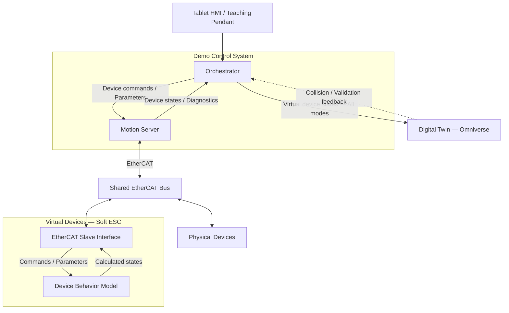
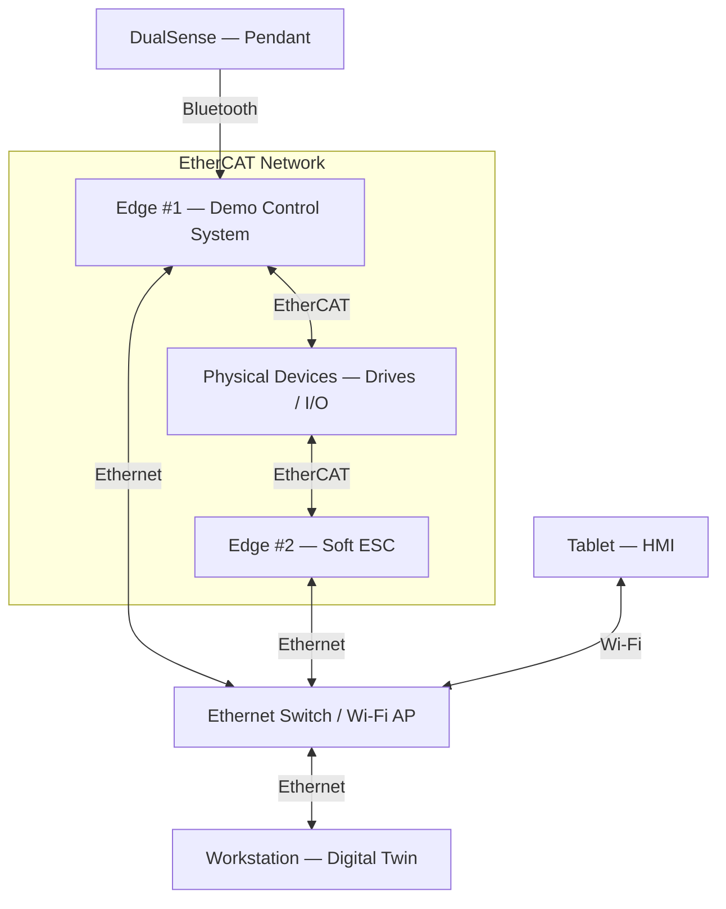
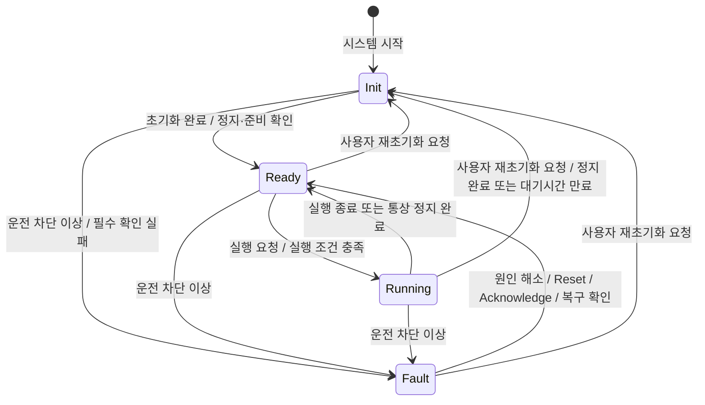

# Fieldbus 기반 Digital Twin 데모 — 시스템 기능·인터페이스 사양서

문서번호: DT-DEMO-SPEC-001 · 버전: 1.2 · 기준일: 2026-11-27

## 1. 문서 목적과 적용 범위

### 1.1 목적

본 사양서는 Fieldbus 기반 Digital Twin 데모의 시스템 구성, 운전 기능, 장치 제어, 상태 관리 및 인터페이스에 대한 구현 요구사항을 정의한다. Orchestrator, Soft ESC 및 Digital Twin 구현과 통합 시 본 사양서를 기준으로 사용한다.

“한다”로 기술한 항목은 적용 요구사항이다. TBD는 기능 원칙을 유지하되 구현 시 값·형번·절차를 확정해야 하는 항목이다. 설계 요구사항과 구현·시험 완료 여부를 구분한다.

### 1.2 1차 구현 범위

| 구분 | 적용 범위 |
|---|---|
| 대상 공정 | Underfill dispensing 적용 맥락의 PCB Loading → Gantry Path Execution → PCB Unloading |
| 실제 시연 | 액체 토출 없이 갠트리 이동 경로와 Loader 동작 시연 |
| 구동 장치 | X1·Y·Z 구동축, X2 수동 Guide Axis, Loader 및 양단 센서·밸브 I/O |
| 제어 | Manual / Auto, DT / Sync, HMI / Pendant 입력, Teaching·Recipe·Parameter Pairing·State Alignment |
| 가상 장치 | Soft ESC의 EtherCAT Slave 인터페이스 및 장치 동작 모델 |
| Digital Twin | Omniverse의 가상 장치 Follow 표시 및 충돌 검출 피드백 |
| 외부 연계 | 기존 Motion Server TCP API, Digital Twin용 ROS 2 인터페이스 |

### 1.3 제외 범위

- 실제 재료 토출 및 Underfill 품질 검증은 포함하지 않는다.
- CSP, 축간 경로 보간, 축간 도착 시간 동기화 및 블렌딩은 사용하지 않는다. 독립 PP 이동의 중간 툴 경로를 직선으로 보장하지 않는다.
- Festo AX는 2차 구현 범위로 분리한다.
- Omniverse 내 장치 동작 모델 실행 및 Follow / Modeling 모드 전환은 이번 범위에 포함하지 않는다.
- 중단한 자동 운전의 단계 중간 재개는 제공하지 않는다.
- Motion Server의 신규 기능 개발을 요구하지 않는다. 실제 사용하는 기존 API의 지원 범위와 제약을 확인하여 연계한다.

## 2. 시스템 구성과 책임

### 2.1 시스템 구성도



### 2.2 구성 요소별 책임

| 구성 요소 | 구현 책임 | 경계 |
|---|---|---|
| Orchestrator | 운전 모드, 실제·가상 Pairing, 지령 대상 선택, Manual 지령 생성, Sequence·Repeat·Recipe, 상태 관리, HMI·Pendant 및 ROS 2 연계 | 장치별 PDO/SDO 처리는 Motion Server에 요청한다. |
| Motion Server | EtherCAT Master, 개별 장치 ID 기반 제어, PDO/SDO, 상태·진단 및 기존 통신·제어권 관리 | DT/Sync·Recipe·Pairing 정책은 Orchestrator가 담당한다. |
| Soft ESC | 가상 EtherCAT Slave 및 축·Loader 등 장치 동작 모델, 가상 상태·DI 생성 | Omniverse가 제어용 센서 상태를 생성하도록 하지 않는다. |
| Digital Twin | 가상 축 위치·I/O의 3D 표시, 충돌 검출·해소 결과 제공 | 모든 모드에서 가상 장치 상태를 추종하며 별도 장치 동작을 중복 계산하지 않는다. |
| HMI | 운전 요청·설정·티칭·상태 표시 | 요청의 허용·적용 여부는 Orchestrator가 결정한다. |
| Pendant | 설정파일로 매핑된 논리 기능 요청, LED·햅틱 | 별도 Motion Server 제어권 소유 연결을 추가하지 않는다. |

### 2.3 하드웨어 배치

| 하드웨어 | 기능 | 실행 소프트웨어 | 연결 |
|---|---|---|---|
| Edge #1 | Demo Control System | Orchestrator + Motion Server | EtherCAT Master NIC, Ethernet, Pendant Bluetooth |
| Edge #2 | Soft ESC | Slave 인터페이스 + 장치 동작 모델 | EtherCAT Slave NIC, Ethernet |
| Workstation | Digital Twin | Omniverse | Ethernet |
| Tablet | HMI | Web Browser | Wi-Fi |
| DualSense | Pendant | N/A | Bluetooth → Edge #1 |



### 2.4 공통 Fieldbus 요구사항

| ID | 요구사항 |
|---|---|
| ARC-01 | Motion Server 한 인스턴스가 공통 EtherCAT 버스의 실제·가상 장치와 통신한다. |
| ARC-02 | DT/Sync와 관계없이 실제·가상 Slave 연결 및 주기 통신을 유지하고, 운전 모드에 따라 명령 대상만 선택한다. |
| ARC-03 | 실제·가상 장치는 독립 Slave ID를 유지하며 Orchestrator의 Pairing 테이블로 논리적으로 연결한다. |
| ARC-04 | 동일 논리 지령 전송을 동일 EtherCAT 주기 실행 또는 실제·가상 상태의 완전 일치 보장으로 해석하지 않는다. |
| ARC-05 | 모든 모드의 표시 데이터 경로는 가상 장치 → Motion Server → Orchestrator → Digital Twin으로 한다. |

## 3. 장치 및 I/O 사양

### 3.1 Motion Devices

| 축 | 기구 작업 기준 | 모터 | 컨트롤러 | 수량 | 가상 대응 |
|---|---|---|---|---|---|
| X1 | EGC-70-370-TB-KF-0H-GK (556813) | TBD | CMMT-AS-EC | 각 1 | 가상 드라이브 + 동작 모델 |
| X2 | 부하 지지용 Guide Axis, 상세 TBD | 없음 | 없음 | 축 1 | 기구 관계에 따른 DT 표현 |
| Y | EGC-80-300-TB-KF-0H-GK (556814) | TBD | CMMT-AS-EC | 각 1 | 가상 드라이브 + 동작 모델 |
| Z | ELGD-BS-KF-80-300-0H-… | TBD | CMMT-AS-EC | 각 1 | 가상 드라이브 + 동작 모델 |

구동축은 X1·Y·Z 3축이다. X2에는 독립 지령·가상 드라이브·Servo 제어를 구성하지 않는다. 모터는 3대, 컨트롤러는 3대이며 표의 기구 형번은 기존 자료의 작업 기준이다. 발주 형번·모터 결합 부품은 구현 시 확정한다.

### 3.2 Loader 및 I/O

| 품목 | 사양 | 수량 | 확정 범위 |
|---|---|---|---|
| Loader 실린더 | DGC-32-300-… | 1 | 상세 형번 TBD |
| Loader 밸브 | 실제 밸브 구성 TBD | 1식 | single valve / VTUX 표기 정리 후 선정 |
| 양단 위치 센서 | 24 VDC DI | 2 | Unload(초기 끝단) / Load |
| EtherCAT Remote I/O | CPX-E-EC 또는 CPX-AP-I-EC-M12 후보 | 1식 | 최종 모델·모듈 TBD |
| DI | 최소 2점 | 모듈 수 TBD | 양단 센서 입력 |
| DO | 밸브 구성에 따른 점수 | TBD | 밸브 출력 |

DI/DO 모듈은 Remote I/O 구성의 하위 항목으로 산출하며 별도 완제품 수량으로 중복 합산하지 않는다. 네트워크 Switch/AP·NIC·케이블·전원·배선·공압 배관·장착 부품의 모델과 수량은 구현 시 산출한다.

### 3.3 가상 I/O 처리

| ID | 요구사항 |
|---|---|
| IO-01 | I/O의 Input / Output 방향은 EtherCAT Master를 기준으로 한다. |
| IO-02 | Soft ESC는 가상 DO → 밸브·Loader 동작 모델 → 가상 DI의 관계를 구현한다. DO 값을 DI에 단순 복사하지 않는다. |
| IO-03 | Loader 모델의 동작 결과로 양단 센서 상태를 생성한다. 밸브 출력 해제 시 동작은 선정된 실제 밸브 구성에 맞춰 정한다. |
| IO-04 | Omniverse의 밸브는 가상 DO에, Loader는 가상 DI에 연결한다. DT/Sync에 따라 실제 I/O로 전환하지 않는다. |
| IO-05 | 양단 센서 OFF만으로 중간 위치·방향을 확정하지 않는다. Loader 중간 이동은 시각화용이며 끝단 센서 ON 시 해당 위치에 맞춘다. |
| IO-06 | Omniverse의 애니메이션을 가상 DI 생성이나 공정 완료 판정의 입력으로 사용하지 않는다. Loader 내부 연속 위치용 별도 전달 인터페이스는 추가하지 않는다. |

## 4. 운전 모드와 제어권

### 4.1 모드 정의

| 구분 | 값 | 결정 대상 |
|---|---|---|
| Target Mode | DT / Sync | 명령을 받을 장치 |
| Operation Mode | Manual / Auto | 수동 지령 / Sequence 실행 |
| Manual Control Source | HMI / Pendant | Manual의 일반 동작 지령 생성 주체 |
| Pendant 조작 방식 | Single Axis / Multi Axis | 단축 Jog / 다축 PV |
| HMI 조작 방식 | Jog / Positioning | Jog / PP 이동. Single/Multi 구분 없음 |

### 4.2 모드별 동작 대상

| 모드 | 명령 생성 | 명령 대상 | Digital Twin 추종 |
|---|---|---|---|
| DT · Manual | 선택된 HMI / Pendant | 가상 장치 | 가상 장치 상태 |
| DT · Auto | Orchestrator Sequence | 가상 장치 | 가상 장치 상태 |
| Sync · Manual | 선택된 HMI / Pendant | Pairing된 실제·가상 장치 | 가상 장치 상태 |
| Sync · Auto | Orchestrator Sequence | Pairing된 실제·가상 장치 | 가상 장치 상태 |

### 4.3 선택·요청 및 권한

| ID | 요구사항 |
|---|---|
| MOD-01 | Target Mode, Operation Mode 및 Manual Control Source는 HMI에서 요청하고 Orchestrator가 Ready 및 전환 조건을 확인하여 적용한다. |
| MOD-02 | Manual Control Mode 변경도 Ready에서 허용한다. HMI는 Orchestrator가 반환한 실제 선택 상태와 거부 이유를 표시한다. |
| MOD-03 | Manual의 일반 동작은 한 번에 하나의 Control Source만 생성한다. HMI·Pendant에서 같은 기능은 출처를 포함한 같은 공통 명령으로 전달하고, System Controller가 출처와 현재 조건에 따라 접수 여부를 판단한다. Auto의 지령 생성은 Sequencer가 담당한다. |
| MOD-04 | HMI의 Stop·초기화·Fault 해제는 Pendant 선택 중에도 사용할 수 있다. |
| AUT-01 | Motion Server 제어권은 사용자가 HMI에서 명시적으로 획득·반납 요청한다. TCP 연결·재연결 후 자동 획득하지 않는다. |
| AUT-02 | Orchestrator가 자신의 기존 서버 연결에서 제어권 요청을 수행한다. Manual Control Source와 Motion Server 제어권 소유자를 구분한다. |
| AUT-03 | 제어권 요청 전송만으로 획득 완료로 표시하지 않고 서버 결과를 확인한다. 재연결 후 이전 제어권·명령·Sequence를 자동 복원하지 않는다. |

## 5. 시스템 상태 및 복구

### 5.1 상태 정의

| 상태 | 정의 |
|---|---|
| Init | 설정·통신·장치 초기화와 정지·준비 상태를 확인한다. |
| Ready | 초기화를 완료하고 동작 또는 자동 운전 시작을 기다린다. |
| Running | 수동 이동·Homing·State Alignment 또는 자동 운전을 실행한다. Sequence의 센서 대기·Dwell·단계 전환도 포함한다. |
| Fault | 운전을 차단하는 이상에 대해 정지 처리하고 원인 해소 및 명시적 복구를 기다린다. 충돌 해소용 단축 Jog 예외는 5.4를 따른다. |

시스템 상태는 EtherCAT 상태 및 드라이브 CiA402 상태와 구분한다. Servo On 자체는 Running을 뜻하지 않으며 Fault 또는 Init이라는 표시만으로 물리적 정지 완료를 의미하지 않는다. 모든 개별 Error 응답을 시스템 Fault로 승격하지 않는다.

### 5.2 상태 전이

| 전이 | 조건·결과 |
|---|---|
| 시작 → Init | 설정 로드, 연결 및 장치 구성·Pairing 확인 |
| Init → Ready | 필수 초기화·통신·장치 정지·현재 모드 준비 확인, 운전 차단 Fault 없음 |
| Ready → Running | 유효한 동작 요청과 실행 조건 충족 |
| Running → Ready | 전체 동작·운전 종료 또는 통상 정지 완료 |
| Init / Ready / Running → Fault | 운전 차단 이상 또는 초기화 후 필수 확인 실패 |
| Fault → Ready | 원인 해소, 필요한 장치 Reset, 사용자 확인, 정지·준비 상태 확인 |
| 모든 상태 → Init | 사용자 초기화 요청. 제한 시간 정지 시도 후 Init 진행 |
| Init 중 초기화 요청 | 기존 초기화를 계속 수행하고 중복 시작하지 않음 |



### 5.3 Stop·Fault 해제·초기화

System Controller는 실행 중인 동작과 충돌하는 일반 명령을 즉시 거절하며, 나중에 실행하도록 대기열에 넣지 않는다. Stop은 일반 명령보다 우선 처리한다. Manual Controller와 Auto Controller는 각자 맡은 실행의 결과를 System Controller에 보고한다. System Controller는 현재 유효한 실행에 속하는 완료 보고를 상태 전이에 반영한다. 실행 실패 시에는 보고된 실패 사유와 현재 장치 상태를 기준으로 시스템 Fault 전이 여부를 판단한다. 수동은 동작 한 건, 자동은 Auto Start부터 전체 운전 한 건당 최종 결과를 한 번 보고한다. 보고에는 대상 실행, 완료·실패·취소 여부, 실패·취소 시 사유를 포함한다.

| 기능 | 처리 절차 | 완료·실패 판정 |
|---|---|---|
| 통상 Stop | System Controller가 접수하고 진행 중인 실행을 취소한다. Manual/Auto Controller는 후속 지령을 중단하고 Auto Controller는 반복 예약을 취소한다. System Controller는 Device Manager를 통해 현재 모드의 운전 대상 전체에 정지를 요청한다. DT에서는 가상 장치 전체, Sync에서는 실제·가상 장치 전체가 대상이다. DT의 State Alignment로 실제 Loader가 초기 복귀하는 중에는 실제 Loader도 정지 대상에 포함하고 정렬을 실패로 종료한다. | System Controller는 정지 확인 중 Running을 유지하고, Stop 요청을 보낸 뒤 받은 유효한 피드백으로 모든 대상 장치의 정지를 확인한 뒤 Ready로 전이한다. 정지 확인 제한 시간은 System Controller가 Stop을 접수한 시점부터 계산한다. 기본값은 2초이며 Orchestrator 설정으로 변경할 수 있다. 만료 시 Fault 및 정지 미확인 표시 |
| Fault 해제 | 원인 해소 → 필요한 장치 Reset → 사용자 확인 → 정지·준비 확인 | 충족 시 Ready. 미충족 시 Fault 유지. 자동 재실행 없음 |
| 초기화 | 신규 동작 차단·실행 취소 → 제한 시간 정지 요청·대기 → Init → 필수 확인 | 정지 대기 만료도 기록 후 Init 진행. Init 후 정지·준비 확인 성공 시 Ready, 실패 시 Fault |

1차 데모의 축 정지는 Stop 요청 이후 받은 유효한 피드백의 Statusword bit 8(B8)=0으로 즉시 판정한다. 실제·가상 축 모두에서 이동 중 B8=1과 정지 시 B8=0을 검증하고, 실제 속도는 진단·검증에 사용한다. Ready 전환에는 정지 확인과 별도로 Fault가 해소되어 있어야 한다.

1차 데모에서 Loader 정지는 Stop 이후 받은 유효한 피드백에서 끝단 센서 하나만 ON이고, 해당 끝단을 유지하는 실제 밸브·공압 회로 또는 가상 모델 동작이 사전 검증된 경우에 확인한다. 양쪽 끝단 센서가 OFF이면 정지 미확인으로 처리한다. 제한 시간 내 정지를 확인하지 못하면 System Controller가 Fault로 전이하고 정지 미확인을 표시한다.

초기화 요청은 Running에서 정지 요청이 수행되지 않는 상황에도 가능해야 한다. 이전 지령 재전송, 장치 자동 Enable 및 이전 운전 자동 재개를 초기화 절차에 포함하지 않는다. 모든 축의 Homing 완료를 Ready 진입의 일괄 조건으로 요구하지 않고, 개별 동작에 필요한 Homing을 실행 조건으로 확인한다.

### 5.4 충돌 처리

| 항목 | 사양 |
|---|---|
| 검출 경로 | Digital Twin → ROS 2 → Orchestrator |
| 정지 대상 | DT: 가상 장치. Sync: 실제·가상 장치 모두 |
| 시스템 처리 | Stop 요청, 실행·반복·대기 동작 취소, Fault |
| 간섭 해소 | Fault 상태에서 기존 단축 Jog를 예외적으로 활용한다. 별도 복구 모드·버튼·자동 탈출 방향 판단 기능은 추가하지 않는다. |
| 복구 완료 | 충돌 원인 해소 후 사용자 Fault 해제 및 정지·준비 확인 → Ready |

드라이브의 기존 S/W Limit·허용 방향 제한을 Orchestrator에 중복 구현하지 않는다. 드라이브 S/W Limit과 기하학적 충돌은 구분하며 드라이브가 모든 충돌의 탈출 방향을 판단한다고 가정하지 않는다. 충돌 해소 메시지만으로 Fault를 자동 해제하거나 운전을 재개하지 않는다.

## 6. Manual Control

### 6.1 기능 사양

| ID | 기능 | 입력·처리 | 완료·정지 |
|---|---|---|---|
| MAN-01 | Pendant Single Axis | 선택한 X1·Y·Z 중 한 축에 Jog 지령 | 중립 시 Jog 정지 |
| MAN-02 | Pendant Multi Axis | 스틱 입력으로 축별 PV 속도 벡터 생성 | 중립 시 정지 요청. Enable 해제는 직접 Servo Off |
| MAN-03 | HMI Jog | 축별 - / + 버튼과 Jog 속도 | 누르는 동안 이동, 놓으면 정지 요청 |
| MAN-04 | HMI Positioning | 축별 목표 위치 및 PP 조건. 축별 실행 또는 선택 축 함께 실행 | 대상 축의 도달·정지 확인. 보간·동시 도착 없음 |
| MAN-05 | Servo | HMI 축별·전체 On/Off. Pendant Trigger–Enable 직접 연결 | 실제 구동 상태 Feedback 확인 |
| MAN-06 | Homing | HMI 축별, Pendant 단축 선택 축 요청 | Running 관리, 완료 후 Ready. 실패·timeout 시 정지 요청 및 Fault |
| MAN-07 | Loader | Unload(초기 끝단) / Load 이동 요청 | 해당 대상의 끝단 센서 확인. 가상 Loader는 정상 완료 후 선택된 밸브 출력을 다음 Loader 이동 지령 또는 공통 Stop까지 유지 |

일반 수동 동작은 Manual 및 선택된 Control Source에서 요청한다. 제어권·장치 준비 및 개별 동작 조건은 Orchestrator가 확인한다. Sync에서는 Pairing된 실제·가상 장치에 같은 논리 지령을 보낸다.

### 6.2 Trigger 및 속도 제한

HMI 또는 Pendant의 Jog/PV 조작 입력이 끊기면 Orchestrator가 해당 동작을 정지시킨다. 재연결 후에는 새 조작 입력으로만 동작을 시작한다.

- Manual의 Pendant Trigger 누름·해제는 Enable(Servo On/Off)에 직접 연결한다. 해제 시 별도의 “정지 요청 → 정지 확인 → Servo Off” 절차를 추가하지 않는다.
- Pendant Multi Axis PV의 S/W Limit 거리 기반 속도 제한은 Orchestrator가 수행한다. 현재 위치와 한계 위치의 상대거리 및 필요한 감속을 반영하여 한계를 넘지 않도록 지령을 제한한다.
- 처리 순서는 스틱 입력 → 속도 벡터 → 한계 거리 기반 제한 → Motion Server 지령으로 한다. 이 기능을 일반 Jog 기능으로 명명하거나 Motion Server에 추가하지 않는다.
- 계산식·감속·지연·여유 거리·갱신 주기와 Sync의 실제·가상 위치 반영 기준은 구현 시 확정한다.

## 7. Teaching 및 Recipe

### 7.1 Recipe 데이터

| 데이터 | 형식·의미 |
|---|---|
| Recipe 이름 | 저장·선택에 사용하는 이름 |
| 장치 참조 | X1·Y·Z 등 논리 장치 이름 |
| 경유점 | P1~P10에 최대 10개 저장 |
| 사용 포인트 수 N | 사용자가 Recipe별로 1~10 지정. Auto는 P1부터 PN까지 실행 |
| 좌표 | 각 점의 X1·Y·Z 목표 위치 |
| PP 속도 | 축별 기본값 및 경유점별 변경값 |
| PP 가속도·감속도 | 축별 기본값 및 경유점별 변경값 |
| Dwell | 해당 점의 모든 대상 축 도달·정지 후 대기 시간 |

### 7.2 편집·티칭·저장 요구사항

| ID | 요구사항 |
|---|---|
| RCP-01 | Recipe는 Orchestrator가 관리하며 편집·불러오기·저장은 Ready에서 허용한다. |
| RCP-02 | 현재 위치 등록은 Manual·Ready·정지 확인 후 수행한다. 한 점에 X1·Y·Z를 함께 기록한다. |
| RCP-03 | 티칭 기준은 DT의 가상 현재 위치, Sync의 실제 현재 위치로 한다. 요청은 HMI·Pendant 모두 허용한다. |
| RCP-04 | P1~P10에 대기·작업·상승·복귀 등 고정 공정 역할을 부여하지 않는다. 첫 점과 마지막 사용 점의 좌표에는 각각 독립적인 값을 지정할 수 있다. |
| RCP-05 | Auto는 마지막으로 저장한 Recipe를 사용한다. 미저장 편집값을 실행 데이터에 자동 반영하지 않고 변경·저장 필요 상태를 표시한다. |
| RCP-06 | 입력 오류와 S/W Limit 초과를 표시한다. Recipe의 직접 좌표 편집과 수동 이동 조작을 구분한다. |
| RCP-07 | 사용 포인트 수는 Ready에서 HMI로 편집하고 Recipe에 저장한다. 수를 줄여도 뒤쪽에 등록한 포인트는 보존한다. Auto Start 전에 사용 구간의 모든 포인트가 등록되어 있고 유효한지 확인한다. |

### 7.3 경유점 실행

1. 저장된 사용 포인트 수 N에 따라 P1부터 PN까지 순서대로 실행한다.
2. 각 점에서 X1·Y·Z에 독립 PP 위치결정 지령을 전달한다.
3. DT는 대상 가상 축 전부, Sync는 대상 실제·가상 축 전부의 목표 도달·정지를 확인한다.
4. 완료 확인 후 해당 점의 Dwell을 시작하고 종료 후 다음 점으로 진행한다.
5. 마지막 사용 포인트의 이동·대기가 끝나면 상위 Sequence에 완료 결과를 반환한다. Loader 단계나 Repeat가 남아 있으면 Running을 유지한다.

먼저 도착한 축은 나머지 대상 축의 완료를 기다린다. 경유점별 이동 timeout, 위치 허용오차 및 정지 기준은 구현 시 정한다. 이동·대기 중 이상·timeout은 기존 Fault 처리로 연결한다.

## 8. Auto Control 및 공정 Sequence

### 8.1 Auto 실행 제어

| 항목 | 사양 |
|---|---|
| Start 요청 | HMI 또는 Pendant |
| Start 조건 | Auto·Ready, 유효한 저장 Recipe, 제어권·통신·대상 장치 준비 및 필요한 Servo·Homing 조건 |
| 초기 위치 불일치 | 거부 사유로 사용하지 않고 Cycle Preparation에서 복귀 이동 |
| 실행 중 Start | 중복 요청 거부, 기존 실행 유지 |
| Stop | 현재 실행·다음 사이클 예약 취소, 정지 확인 후 Ready |
| Fault·초기화 후 | 이전 단계·Repeat 자동 재개 없음. 새 Start 필요 |
| Repeat 설정 | HMI에서 Ready일 때 설정. Running 중 변경하지 않음 |
| Cycle 집계 | 정상 완료한 사이클만 집계. Stop 접수 이후 도착한 기존 사이클의 완료 보고는 집계하거나 다음 사이클 시작에 사용하지 않음. 새 Start 시 0으로 초기화 |

### 8.2 Cycle Preparation

| 순서 | 처리 | 진행 조건 |
|---|---|---|
| 1 | Recipe·통신·장치·Servo·필요 Homing 확인 | 기본 실행 조건 충족 |
| 2 | 갠트리·Loader를 정의된 초기 위치로 복귀 | 이미 초기 조건이면 불필요한 이동 생략 |
| 3 | 도달·정지 및 Loader 센서 확인 | 모든 대상 준비 완료 |
| 4 | 한 사이클 Sequence 호출 | Start Check 통과 |

초기 좌표는 티칭 포인트와 별도로 정의한다. Loader의 초기 끝단은 Unload다. 복귀 순서·비간섭 범위와 실제 Loader 신호 매핑은 기구 배치에 따라 구현 시 확정한다. 준비 이동 중에도 Running을 유지하며 실패·timeout 시 Fault로 전환한다. Cycle Preparation을 시스템 Init으로 취급하지 않는다.

### 8.3 한 사이클 Sequence

| 단계 | 실행 | 다음 단계 조건 |
|---|---|---|
| Start Check | Cycle Preparation 완료, 장치 준비·Loader 간섭 조건 확인 | 시작 조건 충족 |
| PCB Loading | Loader 로딩 지령 | 로딩 완료 끝단 센서 확인 |
| Gantry Path Execution | P1~PN 순차 PP 및 Dwell | 각 구간의 모든 대상 완료 |
| PCB Unloading | 갠트리 비간섭 위치 확인 후 Loader 언로딩 | 언로딩 완료 끝단 센서 확인 |
| Cycle Complete | Done 결과 반환 | 상위 Auto Control로 반환 |

Loader 완료는 DT의 가상 센서, Sync의 실제·가상 센서 모두로 판정한다. Sequence는 Done / Aborted / Fault 결과를 반환하며 자체 무한 반복을 포함하지 않는다.

### 8.4 반복 및 재실행

| 결과·설정 | Auto Control 처리 |
|---|---|
| Done + Repeat OFF | 전체 실행 종료 후 Ready |
| Done + Repeat ON | Running 유지, 다음 Cycle Preparation 및 Sequence 시작 |
| Aborted / Stop | 반복 예약 취소. 정상 정지 후 Ready |
| Fault | 반복 예약 취소. 복구 후 자동 재개 없음 |

다음 사이클은 Done 결과로만 시작한다. Ready 진입만으로 재시작하지 않는다. 새 Start는 항상 조건 재확인과 Cycle Preparation부터 수행하며 중단 지점 재개는 하지 않는다.

## 9. Parameter Pairing 및 State Alignment

System Controller가 실행 요청을 심사하고, Device Manager가 접수된 Parameter/PDO Pairing과 State Alignment를 실행한다.

### 9.1 공통 요청 조건

| 항목 | 사양 |
|---|---|
| 요청 경로 | HMI·Pendant 모두 허용. Manual Control Source 선택과 무관 |
| 상태 | Ready에서 명시적으로 요청 |
| 제어권 | Orchestrator가 Motion Server 제어권 보유 |
| Target Mode | DT·Sync 모두 허용 |
| 자동 실행 | 모드 전환만으로 실행하지 않음 |

### 9.2 Parameter Pairing

| 구분 | 사양 |
|---|---|
| 대상 | Pairing된 실제·가상 장치 |
| 방향 | 실제 → 가상 / 가상 → 실제 |
| 조건 | 대상 장치 정지 |
| Motion Parameters | PP 속도·가속도·감속도, S/W Limit |
| PDO Configuration | RxPDO·TxPDO Mapping 및 PDO Assignment |
| 적용 전 | 원본 값과 대상 현재 값을 나란히 조회·표시 |
| 적용 후 | 대상 장치 읽기 결과를 비교하고 성공·실패 및 원인 표시 |

이번 Festo 실제 장치와 가상 장치는 PDO 구성 변경을 지원하는 전제로 구현한다. PDO 항목·순서·비트 길이·크기·의미를 맞추되 Slave 주소나 프로세스 이미지 내 오프셋까지 같게 만들지 않는다. 일반 파라미터 적용과 EtherCAT 상태 전환·프로세스 이미지 갱신이 필요한 PDO 재구성 절차를 분리한다. 기존 Motion Server API로 수행할 경로·제약은 구현 시 확인한다.

### 9.3 State Alignment 처리 절차

| 순서 | 처리 | 완료 조건 |
|---|---|---|
| 1 | 실제 기준 장치 정지 확인, 축 현재 위치·Loader 센서 조회 | 정렬 기준 상태 확인 |
| 2 | 실제 Loader 양단 센서 OFF이면 실제 Loader 초기 복귀 | 초기 끝단 센서 확인 |
| 3 | 이동할 가상 축 Servo On 수행 | Enable 결과 확인 |
| 4 | 실제 위치를 목표로 가상 축 일반 PP 실행, 실제 Loader 상태에 대응하는 가상 I/O 지령 | 대상 도달·정지·센서 일치 확인 |
| 5 | 정렬 결과 표시 및 작업 완료 | 정렬 완료 조건 충족 |

가상 축 Servo On은 사전 사용자 조건이 아니라 정렬 기능의 수행 단계이다. 이동 중에는 Running으로 관리한다. 실제 Loader 초기 복귀는 명시적 State Alignment의 예외 동작으로 DT에서도 허용하며 Sync 전환을 요구하지 않는다. 일반 DT 운전에서는 실제 장치 동작 차단을 유지한다. 이 초기 복귀 도중 공통 Stop을 접수하면 실제 Loader도 정지 요청·피드백 확인 대상에 포함하고 State Alignment를 실패로 종료한다.

일반 지령 경로인 Orchestrator → Motion Server → EtherCAT → 가상 장치를 사용한다. 실제 Loader 초기 복귀 예외 외에는 정렬 이동을 가상 장치에만 보낸다. 모델 상태·가상 원점 덮어쓰기나 별도 Soft ESC 관리 API는 사용하지 않는다. 위치 허용오차·세부 시간 값은 구현 시 확정한다.

## 10. Motion Server 인터페이스 및 시간 관리

Orchestrator 내부 명령과 Recipe는 논리 장치 이름을 사용한다. Device Manager가 실제·가상 장치 매핑을 관리하고, DT에서는 가상 장치로, Sync에서는 매핑된 실제·가상 장치 양쪽으로 운전 지령을 라우팅한다. 일반 운전 지령 전송 전에 Device Manager가 현재 모드와 해당 요청에 필요한 매핑을 모두 확인한다. 하나라도 누락되거나 유효하지 않으면 System Controller가 요청 전체를 거절하며 어느 대상에도 운전 지령을 보내지 않는다.

Sync 지령이 일부 대상에만 접수된 경우 System Controller는 현재 실행을 중단하고 Sync 운전 대상 전체에 공통 Stop을 요청한 뒤 Fault로 전환한다. 기존 Stop 판정 기준을 적용하고, 제한 시간까지 정지를 확인하지 못한 대상은 정지 미확인으로 표시한다.

Sync 지령의 응답 제한 시간이 지나 실행 여부를 확인할 수 없으면 원래 지령을 재전송하지 않는다. System Controller는 현재 실행을 중단하고 Sync 운전 대상 전체에 공통 Stop을 요청한 뒤 지령 접수 여부 미확인을 원인으로 Fault 전이한다. 각 대상의 정지는 유효한 피드백으로 따로 확인한다.

### 10.1 기존 API 사용 범위

| 기능 | Orchestrator 요청 | 확인 데이터 |
|---|---|---|
| Servo | 장치 ID별 Enable / Disable | 실제 구동 상태 |
| Jog / PV | 단축 Jog, 다축 속도 지령 | 위치·속도·운전 상태 |
| PP | 목표 위치 및 PP 이동 조건 | 목표 도달·정지 상태 |
| Homing | 대상 축 Homing | 진행·완료·실패 |
| Stop | 대상 장치 정지 | 실제 정지 여부 |
| I/O | 출력 쓰기·입력 조회 | 출력·센서 상태 |
| 파라미터 | SDO 읽기·쓰기 | 읽기 결과·오류 |
| 초기화·진단 | 기존 초기화·상태 API | 통신·장치 준비·진단 |

장치 API의 요청 성공은 실제 이동 완료가 아니다. Orchestrator는 Feedback으로 완료를 확인한 뒤 다음 단계를 진행한다. 실제 API 명령명·인자·지원 범위는 현 Motion Server 계약에 대응시켜 구현하며 신규 서버 기능을 가정하지 않는다.

### 10.2 통신·Feedback

| 항목 | 사양 |
|---|---|
| 프로토콜 | 기존 Motion Server TCP API |
| 일반 명령 | 새 명령·변경이 필요할 때 전송 |
| Feedback | 기존 서버 설정 주기 사용. 초기 설정 약 100ms |
| 생존 감시 | 기존 서버 Heartbeat / ACK만 사용 |
| 서버 Heartbeat | 현재 서버 설정 유지. 기존 기본값은 challenge 주기 50 ms, 서버의 ACK 대기 200 ms |
| Orchestrator 수신 대기 | challenge 수신 제한 기본 500 ms, 설정 가능. challenge 수신 즉시 ACK. 소켓 종료 감지 시 즉시 연결 종료 처리 |
| 추가 감시 | Feedback 주기 × 5 또는 500ms의 별도 watchdog을 추가하지 않음 |

### 10.3 연결 종료·재연결

| 상황 | 처리 |
|---|---|
| 소켓·Heartbeat 경로로 연결 종료 | Orchestrator 통신 Fault, 신규 동작 차단, 실행·반복·대기 명령 취소 |
| 제어권 소유 연결 종료 | 기존 서버가 전체 구성 축 지령 정리·Disable/Quick Stop 후 제어권 해제 |
| 비소유 연결 종료 | 해당 종료만으로 축 동작 변경 없음 |
| 재연결 | 상태·진단 및 Heartbeat 통신 재개. HMI에서 새 제어권 요청 필요 |
| 운전 재개 | 복구·준비 확인 후 새 명령. 자동 Enable·지령 재실행 없음 |

서버의 기존 연결 종료 처리에 I/O 출력 자동 초기화는 포함되지 않는다. 본 사양서에서 이를 새 서버 기능으로 추가하지 않는다.

### 10.4 작업별 timeout

| 감시 대상 | Timeout 결과 |
|---|---|
| 명령 성공·실패 응답 | 결과 불명 처리. 동작 명령 자동 재전송 없음. Sync 지령의 실행 여부가 불명이면 10장의 공통 Stop·Fault 절차 적용 |
| PP 목표 도달·정지 | Stop 요청 후 Fault |
| Homing 완료 | Stop 요청 후 Fault |
| Loader 끝단 도달 | Sequence 중단 후 Fault |
| 초기화·Parameter Pairing 완료 | 작업 실패 표시, Ready 진입 차단 |
| Stop 후 정지 확인 | Fault 및 정지 미확인 표시. 사용자 초기화는 제한 대기 후 Init 진행 예외 적용 |

Jog·PV에는 이동 완료 timeout을 두지 않는다. 명령 응답과 동작 완료 감시는 연결 생존 감시와 구분한다. 작업별 값은 Orchestrator 설정으로 관리하며 초기화와 같이 오래 걸리는 작업은 별도 응답 대기시간을 사용한다.

## 11. Digital Twin ROS 2 인터페이스

### 11.1 연결 및 토픽 계약

| 토픽 | 메시지 타입 | 발행 → 수신 |
|---|---|---|
| /dt/virtual/joint_states | sensor_msgs/msg/JointState | Orchestrator → Digital Twin |
| /dt/virtual/io_states | control_msgs/msg/DynamicInterfaceGroupValues | Orchestrator → Digital Twin |
| /dt/validation/collision | diagnostic_msgs/msg/DiagnosticArray | Digital Twin → Orchestrator |

Orchestrator의 ROS 2 노드는 기존 Motion Server Feedback에서 가상 상태를 추출하여 Publish하고 충돌 결과를 Subscribe한다. Isaac Sim 사용 시 공식 ROS 2 Bridge와 USD 매핑 처리를 구성한다. 별도 TCP+JSON 인터페이스 또는 UDP JSON 변환 어댑터를 필수로 요구하지 않는다. 표준 메시지를 직접 Publish/Subscribe하며 이를 위해 ros2_control 전체나 MoveIt을 도입할 필요는 없다.

### 11.2 축 위치 메시지

| 필드 | 사양 |
|---|---|
| header.stamp | 상태 취득 시각. 원본 시각이 없으면 Orchestrator Feedback 수신 시각 |
| name | x1_joint, y_joint, z_joint. USD joint/prim 매핑 설정과 대응 |
| position | name과 같은 순서의 현재 위치. 직선 축 단위 m |
| velocity / effort | 제공하지 않으면 빈 배열. 임의의 측정값 0을 채우지 않음 |

```yaml
header:
  stamp: {sec: 100, nanosec: 0}
  frame_id: ""
name: [x1_joint, y_joint, z_joint]
position: [0.150, 0.080, 0.020]
velocity: []
effort: []
```

예시는 X1=150mm, Y=80mm, Z=20mm이다. 실제 장치가 encoder count를 반환하면 축 환산 설정을 적용한다. 방향·원점 offset·USD 매핑은 설정으로 관리한다. 표시 로직은 Soft ESC 위치를 따르며 추가 장치 동역학을 계산하지 않는다.

### 11.3 I/O 메시지

| 필드 | 사양 |
|---|---|
| interface_groups | 논리 I/O 그룹 이름 |
| interface_values | 같은 인덱스의 그룹 값 |
| interface_names / values | 그룹 내 동일 순서의 채널 이름과 값 |
| 디지털 표현 | 0.0=OFF, 1.0=ON |

```yaml
header:
  stamp: {sec: 100, nanosec: 0}
  frame_id: ""
interface_groups: [loader_di, loader_do]
interface_values:
  - interface_names: [home_sensor, end_sensor]
    values: [1.0, 0.0]
  - interface_names: [valve_output]
    values: [0.0]
```

DO 1채널은 형식 예시이며 실제 밸브 점수를 확정하는 의미는 아니다. 채널 번호와 논리 이름의 대응은 설정으로 관리한다. 밸브·Loader 표시 방식은 3.3을 따른다.

### 11.4 충돌 메시지

```yaml
header:
  stamp: {sec: 100, nanosec: 50000000}
  frame_id: ""
status:
  - level: 2
    name: dt/collision
    message: Collision detected
    hardware_id: digital_twin
    values:
      - {key: object_a, value: /World/Gantry/Z}
      - {key: object_b, value: /World/PCB}
```

| 값 | Orchestrator 해석 |
|---|---|
| name=dt/collision, level=2(ERROR) | 충돌 검출. 5.4의 Stop/Fault 처리 |
| 같은 name, level=0(OK) | 유효한 감시 결과의 충돌 해소. 자동 Fault 해제는 하지 않음 |
| WARN / STALE / 미수신 / Publisher 단절 | 충돌 검출 또는 해소로 해석하지 않음 |
| 다른 name의 ERROR | 충돌로 일괄 해석하지 않음 |

메시지 타입은 표준이며 name 및 KeyValue의 의미는 프로젝트 계약이다. 복수 충돌 대상 표현과 짧은 검출의 발행·유지·수신 처리는 구현 시 정한다.

### 11.5 갱신·QoS·재접속

| 항목 | 상태 토픽 2종 | 충돌 토픽 |
|---|---|---|
| 발행 | 새 Motion Server Feedback 수신 시 최신 전체 상태 | 검출·해소 변경 시 즉시, 유효한 현재 결과도 주기 발행 |
| 초기 주기 | 약 100ms Feedback에 맞춤 | 약 100ms |
| History / Depth | Keep Last / 1 | Keep Last / 1 |
| Reliability | Reliable | Reliable |
| Durability | Volatile | Volatile |

Publisher·Subscriber는 호환되는 QoS를 명시한다. 같은 Feedback의 축·I/O에는 동일 상태 시각을 적용한다. 예시의 stamp는 설명용이며 실제 발행은 유효한 시각을 사용한다. 실제 장치 연동의 제어 시간 기준으로 Isaac Sim의 /clock을 사용하지 않는다.

Digital Twin 미연결·연결 단절은 데모 시작·지속을 차단하거나 Stop/Fault를 발생시키지 않는다. 재접속 시 최신 가상 상태부터 추종하고 누락 이력을 재생하지 않는다. ROS 2 발행·콜백 지연이 Motion Server 명령·Heartbeat 처리를 막지 않도록 최신 상태 큐를 사용한다.

## 12. HMI 기능 사양

### 12.1 공통 영역

| 영역 | 요구사항 |
|---|---|
| 상태 | Init / Ready / Running / Fault, 현재 Fault 요약 |
| 모드 | DT / Sync, Manual / Auto, Manual Control Source 선택·실제 적용 상태 |
| 조작 주체 | Manual은 HMI / Pendant, Auto는 Sequencer 표시 |
| 연결·제어권 | Motion Server 연결·제어권 상태, 명시적 획득·반납 |
| 공통 버튼 | Stop, 초기화, Fault 해제. 화면 전환 후에도 유지 |

HMI는 명령을 HTTP로 보내고 같은 요청의 응답으로 접수·거절을 확인한다. 거절 시 현재 상태와 이유를 표시한다. 명령별 완료·실패·취소는 Orchestrator 내부에서 처리하고, HMI는 WebSocket으로 받은 현재 상태를 표시한다. HMI 명령 API에는 `request_id`를 사용하지 않는다. 일반 수동 조작과 공통 정지·복구 요청을 구분한다.

HMI는 WebSocket 연결과 재연결 시 첫 상태 메시지로 최신 Snapshot 전체를 즉시 받아 화면을 초기화한다. 1차 데모에서는 이후에도 같은 연결에서 설정된 주기마다 최신 Snapshot 전체를 받아 화면 상태를 갱신한다. 전송 주기는 Orchestrator 설정으로 변경할 수 있으며 기본값은 100 ms(10 Hz)다. 상태 변경에 따른 추가 전송은 하지 않는다. HTTP 응답 전에 연결이 끊기면 접수 여부 미확인으로 표시하며 이전 명령을 자동 재전송하지 않는다.

WebSocket 연결 단절 또는 상태 갱신 중단 시 HMI는 표시 중인 상태가 최신이 아님을 알리고 일반 운전 명령 전송을 막는다. HTTP 요청이 가능하면 Stop, Disable, Quick Stop은 계속 요청할 수 있으며, Orchestrator는 기존 명령 계약에 따라 접수·거절을 응답한다. 최신 전체 Snapshot을 받은 뒤 HMI는 현재 상태에 따라 일반 운전 조작을 활성화한다.

상태 갱신 중단 기준은 마지막 유효한 Snapshot 수신 후 전송 주기 × 중단 판단 배수다. 배수는 Orchestrator에서 설정할 수 있으며 기본값은 5다. 기본 전송 주기 100 ms에서는 500 ms가 기준이다. WebSocket 단절 감지 시에는 즉시 중단으로 처리한다.

Snapshot에는 시스템 상태와 운전 모드, 수동 조작 소스와 Motion Server 제어권, 실제·가상 축 및 I/O 상태, 현재 Fault와 자동 운전 진행 상태를 포함한다.

### 12.2 화면별 사양

| 화면 | 표시·조작 | 적용 조건·결과 |
|---|---|---|
| Auto Control | 저장 Recipe 선택, Start·Repeat, 현재 단계·경유점·Cycle 수, 실행 불가 사유 | Auto·Ready 및 실행 조건 확인. Repeat는 Ready에서만 변경 |
| Manual Control | 축 위치·Servo·Homing·Fault, Servo 축별·전체, Jog, PP 축별·선택 축, 축별 Homing, Loader 조작·센서·출력 | HMI Control Source에서 일반 수동 조작. Pendant 선택 시 조작 비활성, 상태 표시 유지 |
| Recipe | 새로 만들기·불러오기·저장·다른 이름 저장, P1~P10 표, 사용 포인트 수 설정, 티칭, 이동 조건, 변경·입력 오류 | 좌표·Dwell은 표, 축별 조건은 선택 행 상세. 편집은 Ready, 위치 등록은 Manual·Ready·정지 |
| Device Setup | 실제·가상 ID Pairing, 양방향 Parameter Pairing, PDO 구성, State Alignment, 작업 상태 | 적용 전 비교, 적용 후 읽기 확인. 실행 조건은 9장 |
| Diagnostics | 연결·EtherCAT·제어권, 실제·가상 축·I/O 비교, Fault 상세·복구 안내, 이벤트 이력 | 모든 상태에서 조회 가능 |

### 12.3 상태 표시 기준

- Sync 수동 화면은 실제 위치를 주 표시하고 가상 위치를 함께 표시한다.
- Diagnostics의 위치 차이는 실제 - 가상으로 표시하고 차이만으로 새 Fault를 발생시키지 않는다.
- 통신 단절로 갱신되지 않는 값은 마지막 수신값과 수신 시각으로 표시한다.
- Digital Twin 연결 단절과 충돌 Fault를 분리하여 표시한다.
- 이벤트 이력은 Orchestrator 수집 정보로 관리한다. Fault 발생·해제, 연결·제어권 변경, 초기화·Pairing·Alignment 결과를 포함한다.
- 복구 안내는 다음 조치를 알 수 있도록 표시하고 Fault 해제는 공통 버튼을 사용한다.

## 13. Pendant 기능 및 설정

### 13.1 입력 처리 구조

| 구분 | 사양 |
|---|---|
| 물리 입력 정의 | device_profiles.json: SDL 물리 번호를 논리 버튼·축·트리거 이름과 연결 |
| 기능 매핑 | config.json: 논리 입력과 기능 연결, 축 방향·Deadzone·속도 단계 및 LED·햅틱 설정 |
| 검증 | 알 수 없는 입력과 중복 할당을 검증. Trigger 임계값 설정 지원 |
| 실행 경로 | Pendant → Orchestrator → 기존 Motion Server API |
| 금지 경로 | Pendant 자체 제어권 획득·반납, DT/Sync·Manual/Auto·Control Source 변경 |

특정 DualSense 버튼 배치를 사양에 고정하지 않는다. 기존 Gamepad Control Panel의 분리 구조를 참고하되, 신규 기능은 Orchestrator의 처리와 설정 schema에서 지원해야 한다. 기존 config.json에 항목을 추가하는 것만으로 신규 기능이 구현되었다고 간주하지 않는다.

### 13.2 조작 기능

| 구분 | 기능 |
|---|---|
| 수동 | Trigger Servo On/Off, Single/Multi 전환, 선택 축 변경, 단축 Jog, 다축 PV, 속도 단계 변경, 선택 축 Homing, Loader 이동 |
| 공통 | Stop, Fault 해제, 초기화 |
| 티칭 | P1~P10 선택, 현재 위치 등록 |
| 설정 실행 | Parameter Pairing 방향 선택·실행, State Alignment 실행 |
| 자동 운전 | HMI에서 선택한 Auto 모드·저장 Recipe의 Auto Start |

일반 수동 동작은 Manual·Control Source=Pendant에서 수행한다. Auto Start는 수동 Control Source를 Pendant로 바꾸는 조건을 추가하지 않는다. 초기화는 모든 상태에서 요청 가능하며 Init 중 중복 실행을 시작하지 않는다. Pairing·Alignment는 9장의 조건을 따른다. Recipe 이름·좌표 직접 편집과 PDO 상세·장치 ID 설정은 HMI 기능으로 제공한다.

### 13.3 LED·햅틱

| 표시 상태 | LED | 햅틱 |
|---|---|---|
| Fault | 빨간 점멸 | 축 Fault 발생 시 강한 진동 1회. 시스템 Fault는 없음 |
| Warning | 주황 점멸 | 없음 |
| Homing | 보라 점멸 | 별도 Homing 진동 없음. 축 이동 피드백은 적용 |
| 이동 | Festo Blue | 축 이동 시 약한 연속 진동 |
| Servo Enable·정지 | 초록 | 없음 |
| 제어권 보유·Servo Disable | 청록 | 없음 |
| 연결·제어권 없음 | 파랑 | 없음 |

LED 우선순위는 Fault → Warning → Homing → 이동 → Enable → 제어권 → 연결이다. 이동은 스틱이나 명령이 아닌 축 Feedback으로 판정한다. DT는 가상 대상, Sync는 실제·가상 대상 중 하나라도 이동하면 이동으로 표시한다.

햅틱 입력은 축 Fault·축 이동만 사용한다. Orchestrator의 시스템 Fault·Warning, 시스템 상태 전이 및 작업 결과는 햅틱에 연결하지 않는다. 색상·밝기·점멸·진동 강도·사용 여부를 설정파일로 관리한다. 출력 실패는 데모 운전에 영향을 주지 않는다.

## 14. 기능 확인 기준

아래 항목은 구현 결과를 확인하기 위한 기준이며 시험 완료 기록이 아니다. 수치 허용 기준은 15장의 TBD 확정 후 적용한다.

| ID | 확인 대상 | 기대 결과 |
|---|---|---|
| CHK-01 | DT·Sync의 명령 대상 | DT는 가상, Sync는 실제·가상에 전달. 실제 Loader 정렬 예외는 명시 정렬 요청에서만 수행 |
| CHK-02 | Digital Twin 추종 | 모든 모드에서 가상 축·가상 I/O 표시. 연결 중단 중 운전 유지, 재접속 최신 상태 표시 |
| CHK-03 | 제어권 | 연결·재연결 자동 획득 없음. HMI 명시 요청 결과 반영 |
| CHK-04 | 수동 조작 | Source 선택에 따른 일반 지령 허용, Trigger 직접 Enable, 단축 Jog·다축 PV 구분 |
| CHK-05 | 경유점 실행 | 모든 대상 도달·정지 후 Dwell·다음 점. 마지막 사용 포인트 완료 후 상위 운전 결과 확인 |
| CHK-06 | Recipe 저장 | 미저장 값 미적용, DT·Sync 티칭 위치 구분, 사용 포인트 수 적용 및 미사용 포인트 보존 |
| CHK-07 | Auto Repeat | Done에서만 다음 사이클, Stop/Fault/초기화 후 자동 반복 없음 |
| CHK-08 | 초기화 | 모든 상태에서 요청 가능, 제한 시간 후 Init, 정지·준비 미확인 시 Ready 금지 |
| CHK-09 | State Alignment | 가상 Servo On 후 일반 PP·I/O로 정렬. 원점·모델 상태 덮어쓰기 없음 |
| CHK-10 | Pairing | 원본/대상 비교, 설정 적용, 대상 읽기 결과 확인 |
| CHK-11 | 충돌 | 모드별 Stop/Fault 및 사용자 복구. 단순 Digital Twin 단절과 구분 |
| CHK-12 | 표시·햅틱 | 마지막 수신값 표시, 시스템 상태로 햅틱 미발생, 축 Feedback 기반 피드백 |

## 15. 구현 시 확정 항목

### 15.1 장비·기구 및 설정 값

| ID | 항목 | 확정할 내용 |
|---|---|---|
| TBD-01 | 장치 BOM | 모터·Guide Axis·Z축 상세, 밸브 및 Remote I/O·DO 점수, PC/NIC·배선·배관·장착 부품 |
| TBD-02 | 공정 위치 | 갠트리 초기 좌표, 복귀 순서, 비간섭 범위, 실제 Loader의 Load/Unload 방향 및 I/O 채널 매핑 |
| TBD-03 | PV 제한 | 감속·지연·여유 거리·계산식·갱신 주기 및 Sync의 실제·가상 위치 반영 |
| TBD-04 | 완료·timeout | 위치 허용오차, PP 등 동작 완료 시 정지 판정, Loader 끝단 유지 회로·모델 검증 및 PP·Homing·Loader·초기화·명령 응답 시간 및 공통 Stop 기본값의 통합 시험 검증 |
| TBD-05 | PDO 적용 | 기존 API 대응, EtherCAT 상태·프로세스 이미지 재구성 순서·제약 |
| TBD-06 | Digital Twin | USD·I/O 매핑, Loader 중간 표시, ROS 2·Isaac Sim·OS 및 패키지 호환 |
| TBD-07 | 충돌 전달 | 복수 대상 표현, 짧은 검출의 발행·유지·수신 처리 |
| TBD-08 | 기능 지원 확인 | 실제 Soft ESC 모델·가상 I/O/PDO 지원과 기존 Motion Server API 연계 확인 |

### 15.2 기준 자료

- 기능 근거: DT_Demo_Working_Agreements.md, 2026-11-27 합의 반영본.
- 장치·원본 구성: 사용자 공유 DTDemo_SWArchitecture_rev1.3. 최신 합의가 원본 초안보다 우선한다.
- Pendant 참고: Motion Server의 control_panel/gamepad_control_panel 내 README.md, config.example.json, device_profiles.json, config.py, controller.py.
- ROS 2 메시지·QoS: sensor_msgs/JointState, control_msgs/DynamicInterfaceGroupValues, diagnostic_msgs/DiagnosticArray 및 ROS 2 QoS 공식 정의.

본 사양서의 TBD는 구현 시 확정 항목이다. TBD를 새로운 기능 요구 또는 구현 완료로 해석하지 않는다. Omniverse 모델 통합·Festo AX 등 후속 범위는 본 사양서의 1차 요구사항에 추가하지 않는다.
